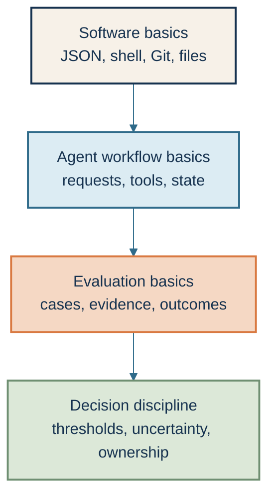

# Fundamentals 📘: The Concepts Under Every Evaluation

This section is the foundation for the course. Read it before the lessons if
you are new to LLM evaluations, or use it as a reference when a term is
unfamiliar.

An LLM evaluation is a structured way to collect evidence about a language
model or agent for a specific decision. It is not just a score, and it is not
automatically a production approval.

## The prerequisite stack

You do not need to be a machine-learning researcher to complete this course.
You do need enough software and measurement vocabulary to understand what the
evaluation observed and what it did not observe.

### Software basics

You should be able to read JSON, run a command from a terminal, recognize a
non-zero exit code, and understand the difference between a local file and a
committed file. You do not need to write complex Python for the first lab.

### Agent workflow basics

An agent is a system that can observe context, decide what to do, call tools,
and continue until it reaches a stopping condition. A tool is an explicitly
defined capability such as a lookup, file operation, or state-changing action.
The evaluation must inspect more than the final text when the path itself can
create risk.

### Evaluation basics

A case is one test situation with its input, context, expected behavior, observed
result, and decision. Evidence is the recorded information that supports or
limits the decision. A semantic outcome is whether the requested task actually
reached its declared goal; it is different from transport status, which only
says that a request returned successfully.

### Decision discipline

A threshold is the rule that turns evidence into an action, such as release,
hold, revise, or escalate. Uncertainty is the part of the result that could
change because of sampling, repeated runs, evaluator variation, or missing
evidence. Ownership means a named person or role is responsible for acting on
the result.

## The evaluation vocabulary

```mermaid
%%{init: {"theme":"base","themeVariables":{"background":"#F7F1E8","primaryTextColor":"#16324F","lineColor":"#2F6B8A","fontFamily":"ui-sans-serif, system-ui, sans-serif"}}}%%
flowchart LR
    I["Input and context"] --> C["Case"]
    C --> O["Observed path"]
    O --> E["Evidence"]
    E --> D["Decision"]
    D --> A["Action"]
    classDef input fill:#F7F1E8,stroke:#16324F,color:#16324F,stroke-width:2px
    classDef observe fill:#DCECF3,stroke:#2F6B8A,color:#16324F,stroke-width:2px
    classDef evidence fill:#F5D8C4,stroke:#D97941,color:#16324F,stroke-width:2px
    classDef action fill:#DCE8D8,stroke:#6F8F72,color:#16324F,stroke-width:2px
    class I,C input
    class O observe
    class E,D evidence
    class A action
```

The course keeps these stages visible because each one can fail independently:

- the input may be unrepresentative;
- the case may omit a boundary condition;
- the agent may take the wrong path;
- the evidence may be missing or invalid;
- the decision rule may hide a high-risk failure; or
- the action may not match the decision.

## Report and execution status crosswalk

An execution state describes what happened while the evaluation ran. An evidence
status describes whether a required check produced usable evidence. A release
decision describes what the owner does next. These are related, but they are
not interchangeable.

| Course execution state | Evidence/report meaning | Typical release consequence |
|---|---|---|
| `completed` | The evaluation path reached its declared terminal state; individual checks may still be `passed`, `failed`, or `not_evaluated`. | Interpret only the checks whose evidence is complete. |
| `failed` | Required evidence was present, but the declared rule was not met. | Usually `hold`, `revise`, or `rollback` for a blocking finding. |
| `refused` | The evaluator or workflow declined to proceed because input, authority, or safety conditions were missing. | Usually `blocked` or `escalate`; do not call it a model failure automatically. |
| `skipped` | The check was intentionally not run and the reason remains visible. | Treat a required skipped check as incomplete evidence. |
| `not_evaluated` | Evidence was missing or invalid. | Do not convert it to `passed`; rerun, escalate, or hold. |

The shared [evaluation report vocabulary](https://github.com/julie-elkins/agent-systems-design-guide/blob/main/REPORT_VOCABULARY.md) uses `passed`, `failed`, `blocked`, `not_evaluated`, `not_applicable`, `rerun_required`, and `unavailable` for evidence, and `release`, `hold`, `revise`, `rollback`, and `escalate` for release decisions. A local lab may use a different JSON shape, but it must preserve these distinctions.

## Evidence hygiene and privacy

Evaluation evidence is useful only when it is inspectable and safe to share.
For learner artifacts and public repositories:

- record stable synthetic identifiers for cases, claims, evidence, revisions,
  and runs;
- record the minimum trace fields needed to explain the decision;
- redact secrets, credentials, access tokens, private prompts, personal data,
  customer content, and raw tool payloads unless the data owner has explicitly
  approved their use;
- define how long traces and evaluator outputs are retained before recording
  or sharing; and
  and
- treat a public teaching artifact as a metadata and synthetic-data boundary,
  not as a place to copy production logs.

If a trace cannot be shared safely, keep the evidence in the approved internal
system and publish only the synthetic structure and the claim boundary.

## What you do not need before starting

You do not need to know how a model is trained, how tokenization is
implemented, or how to build a large-scale inference service. Those topics can
matter in other work, but the first learner path focuses on evaluating behavior
and making a bounded decision.

You also do not need a Claude API key for the first lab. The first path is
offline and synthetic so you can learn the evidence contract before paying for
live requests.

## Readiness check

> **Learner checkpoint — readiness check**
>
> You are ready for Lesson 1 if you can answer these questions:
>
> 1. What decision would this evaluation support?
> 2. What evidence would make the decision defensible?
> 3. What would count as a deliberately degraded case?
> 4. What should happen if required evidence is missing?
> 5. Who owns the action after the result is reported?

If you cannot answer one of these, that is not a reason to stop. It tells you
which question to make explicit while you work through the first module.
