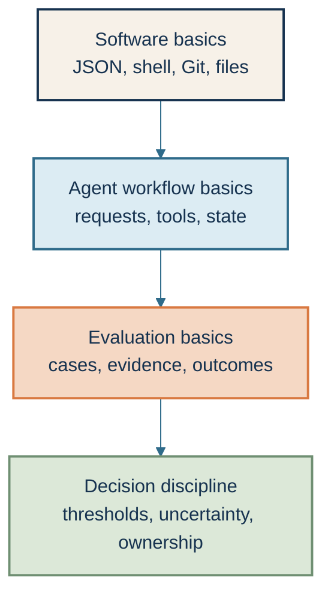
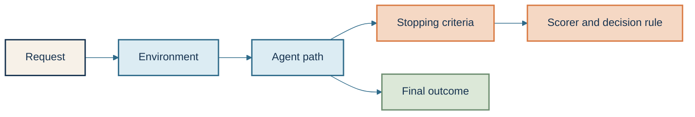
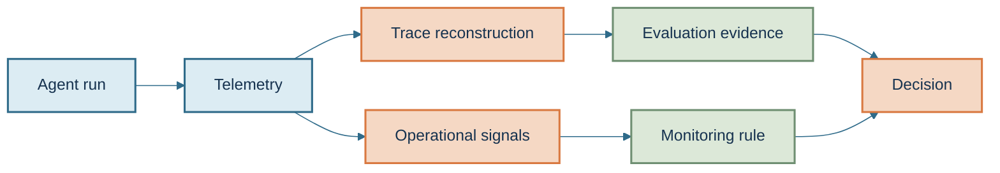

# Fundamentals 📘: The Concepts Under Every Evaluation

This section is the foundation for the course. Read it before the lessons if
you are new to LLM evaluations, or use it as a reference when a term is
unfamiliar.

An LLM evaluation is a structured way to collect evidence about a language
model or agent for a specific decision. It is not just a score, and it is not
automatically a production approval.

## The prerequisite stack

You do not need to be a machine-learning researcher to complete this course.
You do need enough software and measurement vocabulary to understand what the
evaluation observed and what it did not observe.

### Software basics

You should be able to read JSON, run a command from a terminal, recognize a
non-zero exit code, and understand the difference between a local file and a
committed file. You do not need to write complex Python for the first lab.

### Agent workflow basics

An agent is a system that can observe context, decide what to do, call tools,
and continue until it reaches a stopping condition. A tool is an explicitly
defined capability such as a lookup, file operation, or state-changing action.
The evaluation must inspect more than the final text when the path itself can
create risk.

### Agent system under test

Before choosing a metric, name the system and the unit of evaluation. For an
agent, record:

- the request or task;
- the environment, including available data, tools, policies, and state;
- the context and memory visible to the agent;
- the stopping criteria, meaning the conditions that end the run;
- the scorer or decision rule, meaning how the observed behavior becomes a
  finding; and
- the final task outcome and the trajectory that produced it.

The same prompt can produce different evidence in different environments. A
tool call that is valid in one environment may be unauthorized in another, and
a final answer that looks correct may have been produced through an unsafe
path. The system under test is the whole bounded workflow, not only the model
response.

### Evaluation basics

A case is one test situation with its input, context, expected behavior, observed
result, and decision. Evidence is the recorded information that supports or
limits the decision. A semantic outcome is whether the requested task actually
reached its declared goal; it is different from transport status, which only
says that a request returned successfully.

### Measurement foundations

The evaluation measures a **construct**, meaning the capability or quality it
claims to measure. **Validity** asks whether the evaluation measures that
construct. **Reliability** asks whether the measurement is reasonably
consistent when the declared conditions are repeated. A reliable evaluation can
still be invalid if it consistently measures the wrong thing.

**Sensitivity** is the evaluator's ability to catch the failures it is meant to
catch. **Specificity** is its ability to avoid failing acceptable cases. A
**false positive** reports a failure when the behavior was acceptable. A
**false negative** reports a pass when a real failure was present. **Calibration**
means checking the evaluator against trusted examples or human-reviewed cases
before relying on its result.

Keep these questions separate:

1. Did the workflow behave correctly?
2. Did the evaluator identify that behavior correctly?
3. Was the evidence sufficient to decide?

### Retrieval, memory, and environment

When an agent uses retrieved context or memory, evaluate those components
separately from the final answer:

- **retrieval recall** asks whether the needed evidence was found;
- **context relevance** asks whether the retrieved material belongs to the task;
- **context sufficiency** asks whether enough evidence was available;
- **grounding** asks whether the answer used the available evidence correctly;
- **memory write correctness** asks whether the right information was stored;
- **memory read correctness** asks whether the right information was later used;
  and
- **stale or conflicting memory** tests whether the agent notices and handles
  outdated or contradictory state.

Reset or version the environment between cases. Otherwise one case can leave
state that changes the next case, making a passing or failing result impossible
to attribute.

### Decision discipline

A threshold is the rule that turns evidence into an action, such as release,
hold, revise, or escalate. Uncertainty is the part of the result that could
change because of sampling, repeated runs, evaluator variation, or missing
evidence. Ownership means a named person or role is responsible for acting on
the result.

### Sampling and uncertainty

An evaluation result describes the cases and runs that were measured; it does
not automatically describe every future user or workflow. Define the target
population, the sampling rule, the case count, and the high-risk slices before
interpreting the result.

Use repeated runs when the agent or evaluator is nondeterministic. Report the
size and direction of a change, not only whether a threshold was crossed. A
confidence interval is a range that communicates uncertainty around an estimate;
it does not repair biased cases, a flawed evaluator, or missing evidence. An
effect is practically important when it changes the decision or risk, even if
it is not large in percentage points.

For a baseline and variant, keep the cases and decision rule matched, identify
what changed, and inspect both the aggregate and the risk slices. A small
overall improvement cannot justify release if a high-impact slice regressed or
the evaluator became less valid.

### Observability and evaluation

Observability is the practice of collecting enough telemetry to explain what a
system did. Telemetry includes traces, events, and metrics. Evaluation is the
separate practice of applying criteria to that behavior so an owner can decide
what to do.

A trace can show that an agent selected a tool, sent arguments, received an
error, retried, and stopped. That explains the path; it does not prove the
behavior was acceptable. An evaluation can say that the tool was unauthorized
or that the state transition was missing; it cannot explain the finding if the
trace omitted the tool span, authorization context, or state before and after
the call.

### Production telemetry basics

Before collecting data, define a minimum trace contract:

- stable `trace_id` and `session_id`;
- workflow, model, agent, and evaluator revisions;
- model, tool, state, evaluator, and terminal events;
- latency, token, cost, retry, and error signals;
- terminal state and evidence completeness; and
- redaction status, retention, and access owner.

An operational metric is a measurement of how the system ran. A service-level
objective, or SLO, is an explicit target for a signal over a defined window.
Neither one replaces task-quality or safety evidence. A fast unauthorized tool
call is still a failure.

### Privacy and incident basics

Telemetry is data. Prompts, outputs, tool arguments, retrieved documents,
identifiers, and state details may need different retention and access rules.
Collect the minimum evidence required by the decision, redact sensitive content,
name the owner, and define how the record is deleted.

An alert is a signal that crossed a declared threshold. An incident is a
condition that requires coordinated action. A useful incident record names the
severity, owner, containment action, rollback trigger, and follow-up evaluation
case.

### Security and assurance controls

Security is not one model score. It is a set of boundaries that must remain
visible across identity, tools, data, networks, side effects, and telemetry.

- A **threat model** names assets, actors, entry points, consequences, and
  controls.
- A **trust boundary** is where authority, data sensitivity, or ownership
  changes.
- **Least privilege** means granting only the authority required for the
  declared task.
- **Output validation** checks model-produced arguments before a downstream
  system performs a side effect.
- **Idempotency** means repeating the same action request does not create an
  unintended duplicate effect.
- **Telemetry security** protects the evidence itself with classification,
  access control, redaction, retention, deletion, and audit records.

```mermaid
%%{init: {"theme":"base","themeVariables":{"background":"#F7F1E8","primaryTextColor":"#16324F","lineColor":"#2F6B8A","fontFamily":"ui-sans-serif, system-ui, sans-serif"}}}%%
flowchart LR
    A["Untrusted input"] --> B["Trust boundary"]
    B --> C["Identity and scope"]
    C --> D["Validated tool action"]
    D --> E["State and audit event"]
    E --> F["Telemetry privacy"]
    F --> G["Monitor and respond"]
    classDef blue fill:#DCECF3,stroke:#2F6B8A,color:#16324F,stroke-width:2px
    classDef orange fill:#F5D8C4,stroke:#D97941,color:#16324F,stroke-width:2px
    classDef sage fill:#DCE8D8,stroke:#6F8F72,color:#16324F,stroke-width:2px
    classDef red fill:#F3D6D2,stroke:#B44B45,color:#16324F,stroke-width:2px
    class A blue
    class B,C orange
    class D,E sage
    class F,G red
```

### Continuous assurance

Continuous assurance is the repeated loop of observing, evaluating, reviewing,
and acting after the first release decision. The loop must distinguish an agent
failure, a monitor failure, and unavailable evidence.

Monitor the monitor with counts for records received, accepted, rejected,
dropped, delayed, and exported. A quiet dashboard is ambiguous unless the
telemetry path itself reports healthy. If required evidence is missing, use
`not_evaluated` or `unavailable`; do not convert silence into a pass.

Track data drift, model drift, evaluator drift, and concept drift separately.
Drift means the measured relationship changed; it does not automatically mean
rollback. Define the comparison window, threshold, owner, and action such as
sampling, recalibration, hold, or rollback.

For state-changing actions, preserve idempotency keys, state versions, approval
identity, compensation action, and audit evidence. A successful final message
does not erase a duplicate, stale, or unauthorized side effect.

## The evaluation vocabulary

```mermaid
%%{init: {"theme":"base","themeVariables":{"background":"#F7F1E8","primaryTextColor":"#16324F","lineColor":"#2F6B8A","fontFamily":"ui-sans-serif, system-ui, sans-serif"}}}%%
flowchart LR
    I["Input and context"] --> C["Case"]
    C --> O["Observed path"]
    O --> E["Evidence"]
    E --> D["Decision"]
    D --> A["Action"]
    classDef input fill:#F7F1E8,stroke:#16324F,color:#16324F,stroke-width:2px
    classDef observe fill:#DCECF3,stroke:#2F6B8A,color:#16324F,stroke-width:2px
    classDef evidence fill:#F5D8C4,stroke:#D97941,color:#16324F,stroke-width:2px
    classDef action fill:#DCE8D8,stroke:#6F8F72,color:#16324F,stroke-width:2px
    class I,C input
    class O observe
    class E,D evidence
    class A action
```

The course keeps these stages visible because each one can fail independently:

- the input may be unrepresentative;
- the case may omit a boundary condition;
- the agent may take the wrong path;
- the evidence may be missing or invalid;
- the decision rule may hide a high-risk failure; or
- the action may not match the decision.

## Report and execution status crosswalk

An execution state describes what happened while the evaluation ran. An evidence
status describes whether a required check produced usable evidence. A release
decision describes what the owner does next. These are related, but they are
not interchangeable.

| Course execution state | Evidence/report meaning | Typical release consequence |
|---|---|---|
| `completed` | The evaluation path reached its declared terminal state; individual checks may still be `passed`, `failed`, or `not_evaluated`. | Interpret only the checks whose evidence is complete. |
| `failed` | Required evidence was present, but the declared rule was not met. | Usually `hold`, `revise`, or `rollback` for a blocking finding. |
| `refused` | The evaluator or workflow declined to proceed because input, authority, or safety conditions were missing. | Usually `blocked` or `escalate`; do not call it a model failure automatically. |
| `skipped` | The check was intentionally not run and the reason remains visible. | Treat a required skipped check as incomplete evidence. |
| `not_evaluated` | Evidence was missing or invalid. | Do not convert it to `passed`; rerun, escalate, or hold. |

The shared [evaluation report vocabulary](https://github.com/julie-elkins/agent-systems-design-guide/blob/main/REPORT_VOCABULARY.md) uses `passed`, `failed`, `blocked`, `not_evaluated`, `not_applicable`, `rerun_required`, and `unavailable` for evidence, and `release`, `hold`, `revise`, `rollback`, and `escalate` for release decisions. A local lab may use a different JSON shape, but it must preserve these distinctions.

## Evidence hygiene and privacy

Evaluation evidence is useful only when it is inspectable and safe to share.
For learner artifacts and public repositories:

- record stable synthetic identifiers for cases, claims, evidence, revisions,
  and runs;
- record the minimum trace fields needed to explain the decision;
- redact secrets, credentials, access tokens, private prompts, personal data,
  customer content, and raw tool payloads unless the data owner has explicitly
  approved their use;
- define how long traces and evaluator outputs are retained before recording
  or sharing; and
- treat a public teaching artifact as a metadata and synthetic-data boundary,
  not as a place to copy production logs.

If a trace cannot be shared safely, keep the evidence in the approved internal
system and publish only the synthetic structure and the claim boundary.

## What you do not need before starting

You do not need to know how a model is trained, how tokenization is
implemented, or how to build a large-scale inference service. Those topics can
matter in other work, but the first learner path focuses on evaluating behavior
and making a bounded decision.

You also do not need a Claude API key for the first lab. The first path is
offline and synthetic so you can learn the evidence contract before paying for
live requests.

## Readiness check

> **Learner checkpoint — readiness check**
>
> You are ready for Lesson 1 if you can answer these questions:
>
> 1. What decision would this evaluation support?
> 2. What evidence would make the decision defensible?
> 3. What would count as a deliberately degraded case?
> 4. What should happen if required evidence is missing?
> 5. Who owns the action after the result is reported?
> 6. What environment, stopping criteria, and scorer define the system under test?
> 7. How would you distinguish workflow correctness from evaluator correctness?
> 8. What retrieval, memory, or state evidence could be missing?
> 9. What uncertainty or high-risk slice could change the decision?

If you cannot answer one of these, that is not a reason to stop. It tells you
which question to make explicit while you work through the first module.
