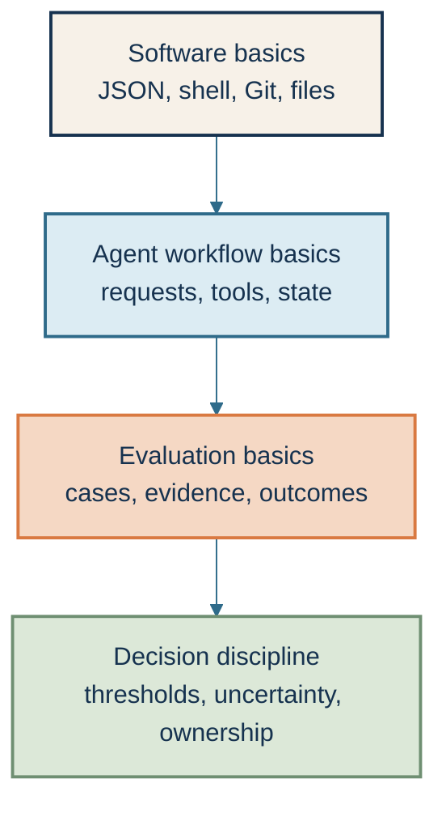
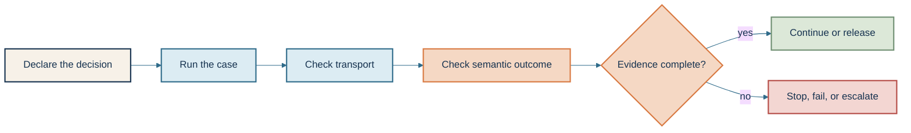
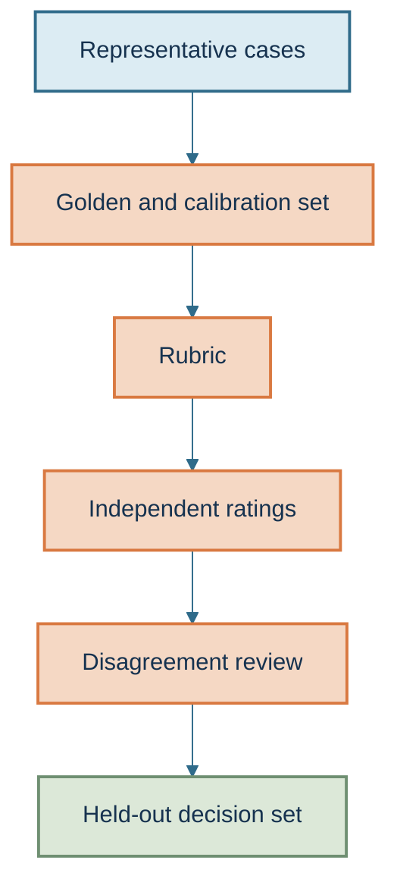
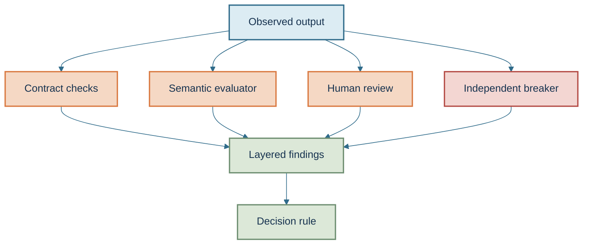
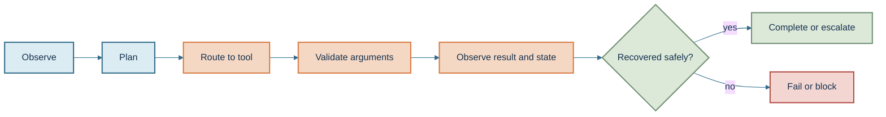
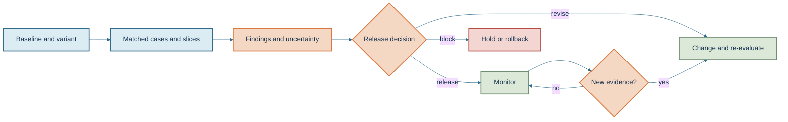

# Claude Evaluation Lab — Learner Guide

<!-- GENERATED FILE. Edit course/lesson-scripts or FUNDAMENTALS.md, then run `uv run python scripts/build_guide.py`. -->

This is the complete learner-facing course in one reading path. The lesson scripts remain the editable recording source; this guide omits speaker notes and recording-only instructions so learners do not need to jump between folders.

## Start here

This course teaches you to design and interpret evaluations for Claude applications and agents. You will learn to connect a declared decision to representative cases, evidence, evaluator layers, and a bounded release action.

If you are new to evaluation work, start with the [fundamentals](FUNDAMENTALS.md) below. If you want the shortest working path, read Module 1 and run [Lab 1](labs/01-semantic-outcomes/README.md) before continuing.

### Companion repositories

- [Claude Architect Lab](https://github.com/julie-elkins/claude-architect-lab) — prerequisite patterns for agent loops, tools, configuration, prompting, context, and reliability.
- [Agent Assurance Harness](https://github.com/julie-elkins/agent-assurance-harness) — the public offline harness used by this course to demonstrate evidence contracts, evaluator controls, and release-boundary checks.

### Learning path

```mermaid
%%{init: {"theme":"base","themeVariables":{"background":"#F7F1E8","primaryTextColor":"#16324F","lineColor":"#2F6B8A","fontFamily":"ui-sans-serif, system-ui, sans-serif"}}}%%
flowchart LR
    A["Declare the decision"] --> B["Design the cases"]
    B --> C["Choose evaluator layers"]
    C --> D["Inspect agent behavior"]
    D --> E["Release, revise, or hold"]
    classDef cream fill:#F7F1E8,stroke:#16324F,color:#16324F,stroke-width:2px
    classDef blue fill:#DCECF3,stroke:#2F6B8A,color:#16324F,stroke-width:2px
    classDef orange fill:#F5D8C4,stroke:#D97941,color:#16324F,stroke-width:2px
    classDef sage fill:#DCE8D8,stroke:#6F8F72,color:#16324F,stroke-width:2px
    class A cream
    class B,C blue
    class D orange
    class E sage
```



## Quick start

```bash
uv run python labs/01-semantic-outcomes/run_lab.py
```

The first five labs are offline and synthetic. They require no Claude API key and demonstrate the path from transport status to a bounded release decision.

## Continue learning

- [Julie’s YouTube channel](https://www.youtube.com/@JulieElkins) — optional video walkthroughs.
- [Julie’s public site](https://julie-elkins.github.io) — projects, learning paths, and design principles.
- [Agent Systems Design Guide](https://github.com/julie-elkins/agent-systems-design-guide) — shared design reasoning and report vocabulary.
- [Apple Platform Agent Quality Lab](https://github.com/julie-elkins/apple-platform-agent-quality-lab) — native macOS implementation of the evaluation boundary.

### Runnable labs

- [Lab 1: Transport success is not task success](labs/01-semantic-outcomes/README.md)
- [Lab 2: Build a case set before you trust the score](labs/02-case-design/README.md)
- [Lab 3: Layer the evaluator before you trust the judge](labs/03-automated-evaluators/README.md)
- [Lab 4: Evaluate the path, not only the final answer](labs/04-agent-behavior/README.md)
- [Lab 5: Turn evaluation evidence into a release decision](labs/05-release-capstone/README.md)

## Fundamentals

This section is the foundation for the course. Read it before the lessons if
you are new to LLM evaluations, or use it as a reference when a term is
unfamiliar.

An LLM evaluation is a structured way to collect evidence about a language
model or agent for a specific decision. It is not just a score, and it is not
automatically a production approval.

#### The prerequisite stack

You do not need to be a machine-learning researcher to complete this course.
You do need enough software and measurement vocabulary to understand what the
evaluation observed and what it did not observe.



##### Software basics

You should be able to read JSON, run a command from a terminal, recognize a
non-zero exit code, and understand the difference between a local file and a
committed file. You do not need to write complex Python for the first lab.

##### Agent workflow basics

An agent is a system that can observe context, decide what to do, call tools,
and continue until it reaches a stopping condition. A tool is an explicitly
defined capability such as a lookup, file operation, or state-changing action.
The evaluation must inspect more than the final text when the path itself can
create risk.

##### Evaluation basics

A case is one test situation with its input, context, expected behavior, observed
result, and decision. Evidence is the recorded information that supports or
limits the decision. A semantic outcome is whether the requested task actually
reached its declared goal; it is different from transport status, which only
says that a request returned successfully.

##### Decision discipline

A threshold is the rule that turns evidence into an action, such as release,
hold, revise, or escalate. Uncertainty is the part of the result that could
change because of sampling, repeated runs, evaluator variation, or missing
evidence. Ownership means a named person or role is responsible for acting on
the result.

#### The evaluation vocabulary

```mermaid
%%{init: {"theme":"base","themeVariables":{"background":"#F7F1E8","primaryTextColor":"#16324F","lineColor":"#2F6B8A","fontFamily":"ui-sans-serif, system-ui, sans-serif"}}}%%
flowchart LR
    I["Input and context"] --> C["Case"]
    C --> O["Observed path"]
    O --> E["Evidence"]
    E --> D["Decision"]
    D --> A["Action"]
    classDef input fill:#F7F1E8,stroke:#16324F,color:#16324F,stroke-width:2px
    classDef observe fill:#DCECF3,stroke:#2F6B8A,color:#16324F,stroke-width:2px
    classDef evidence fill:#F5D8C4,stroke:#D97941,color:#16324F,stroke-width:2px
    classDef action fill:#DCE8D8,stroke:#6F8F72,color:#16324F,stroke-width:2px
    class I,C input
    class O observe
    class E,D evidence
    class A action
```



The course keeps these stages visible because each one can fail independently:

- the input may be unrepresentative;
- the case may omit a boundary condition;
- the agent may take the wrong path;
- the evidence may be missing or invalid;
- the decision rule may hide a high-risk failure; or
- the action may not match the decision.

#### What you do not need before starting

You do not need to know how a model is trained, how tokenization is
implemented, or how to build a large-scale inference service. Those topics can
matter in other work, but the first learner path focuses on evaluating behavior
and making a bounded decision.

You also do not need a Claude API key for the first lab. The first path is
offline and synthetic so you can learn the evidence contract before paying for
live requests.

#### Readiness check

You are ready for Lesson 1 if you can answer these questions:

1. What decision would this evaluation support?
2. What evidence would make the decision defensible?
3. What would count as a deliberately degraded case?
4. What should happen if required evidence is missing?
5. Who owns the action after the result is reported?

If you cannot answer one of these, that is not a reason to stop. It tells you
which question to make explicit while you work through the first module.

## Course map

| Module | Lessons | Learner outcome |
|---|---:|---|
| 1. Evaluation foundations | 1–4 | Identify a false pass and write the evidence needed for a defensible evaluation decision. |
| 2. Evaluation cases and human review | 5–9 | Create a small, risk-based case set with a rubric, calibration plan, and disagreement review. |
| 3. Automated evaluation | 10–18 | Combine deterministic checks, semantic judges, human calibration, and independent negative controls. |
| 4. Factuality, safety, and agents | 19–25 | Evaluate claims, safety boundaries, tool behavior, state changes, and recovery across an agent trajectory. |
| 5. Benchmarks, release, and capstone | 26–30 | Compare a baseline and variant, state uncertainty and limitations, and produce an accountable release recommendation. |

The course uses the cream visual system documented in [course/VISUAL-SYSTEM.md](course/VISUAL-SYSTEM.md). The [glossary](GLOSSARY.md) is a quick reference for evaluation terms.

## Module 1 — Evaluation foundations

**Hands-on outcome:** Identify a false pass and write the evidence needed for a defensible evaluation decision.



### Lesson 1: What an evaluation is—and what it is not

*8 minutes*

**Lab connection:** None; orientation and inspection

#### Learner objective

By the end of this lesson, you can describe an evaluation as evidence collected
against a declared decision, rather than as a single score attached to a model.

#### Core lesson

When people say “we need to evaluate the model,” they may mean several
different things. They may mean: is the answer useful? Is it factually
supported? Did the agent select the right tool? Did it stay within its cost
limit? Did the request finish quickly enough? Or did the change improve the
workflow without making a high-risk case worse?

Those are different questions. If we collapse them into one number, we lose the
reason we were measuring in the first place.

In this course, I will use a narrower definition. An evaluation is a workflow
that collects evidence against a declared decision. The decision might be
whether to release a prompt change, whether to keep a model in production, or
whether a particular agent task is ready for human approval.

That definition has two consequences.

First, the decision comes before the metric. If the decision is whether an agent
is allowed to update a customer record, a useful evaluation needs evidence about
authorization and state change. A high language-quality score does not answer
that question.

Second, the evidence must be bounded. We need to know which workflow, model,
prompt, tools, data, policy, and evaluator produced the result. Otherwise a
passing result may belong to a different system than the one we are about to
change.

The Agent Assurance Harness gives us a small, inspectable example. It records
transport status, semantic outcome, retry count, estimated cost, evaluator
status, and missing evidence. It does not pretend that those fields prove live
model quality. It tells us what was observed for one declared synthetic
scenario.

That distinction is important because evaluation results are often reused beyond
their original scope. A result from a small test set may be repeated in a slide
as if it were a production guarantee. A benchmark score may be quoted as if it
answered a customer-specific question. A successful request may be reported as
task completion even though the response is empty.

We will keep asking one question throughout this course: what decision does this
evidence support, and what does it not support?

In the next lesson, we will write that decision down before choosing a metric.
Then we will run the first lab, where two workflows both receive a successful
transport response but only one has enough evidence to continue.

#### Learner practice

Choose one Claude workflow you care about. Write one sentence beginning:

> “I need evidence to decide whether…”

Then list one thing that sentence does not decide.

#### Boundary

It does not establish that any model, benchmark, or evaluation harness is
universally reliable. It establishes the course's evaluation vocabulary and
decision-first framing.

### Lesson 2: Declare the decision before choosing the metric

*9 minutes*

**Lab connection:** Guided design exercise

#### Learner objective

By the end of this lesson, you can write a decision target, name the failure
that matters most, and choose evidence that can actually support that decision.

#### Core lesson

An evaluation becomes easier to design when the decision is explicit. Without
that sentence, teams often begin by asking which metric is popular or which
benchmark is easy to run. That reverses the dependency.

Consider a Claude assistant that summarizes an internal document. If the
decision is “does the summary sound clear?”, a human rubric for relevance and
readability may be useful. If the decision is “can this summary be sent to a
customer?”, we also need factuality, source support, sensitive-data checks, and
an approval boundary.

The output did not change. The decision changed. That means the evidence must
change.

I use four questions to define the evaluation contract.

First: what user task or system behavior are we evaluating?

Second: what decision will the result support?

Third: what is the most expensive plausible failure? This is not a request to
invent a dramatic scenario. It is a way to prevent an average score from hiding
the one failure that makes release unacceptable.

Fourth: what evidence would allow another person to inspect the result? The
answer may include the final text, but it may also need the tool choice, the
arguments, the authorization state, the source identifiers, the number of
retries, or the state before and after the action.

This is where evaluation layers become useful. A deterministic check is a fixed
rule, such as whether a required field exists or whether an argument matches a
schema. A semantic check evaluates meaning, such as whether the response
addresses the task. A trajectory check evaluates the sequence of actions,
including retries and tool calls. A release check decides whether the evidence
supports the declared change.

No single layer replaces the others. A response can be semantically helpful
while using an unauthorized tool. A tool call can be syntactically valid while
changing the wrong record. A low cost can coexist with an unsafe refusal.

For the exercise, choose one Claude workflow and write four lines:

The task is…

The decision is…

The most expensive plausible failure is…

The evidence I need is…

If you cannot name the evidence, the evaluation is not ready to run. That is
not a failure of the model. It is a missing contract.

The next lesson turns this into a runnable example by separating transport
status from semantic outcome.

#### Learner practice

Complete the four-line evaluation contract for one workflow. Add one negative
case that would look successful if you checked only the request status.

#### Boundary

A well-written contract does not prove that the chosen evidence is sufficient.
It makes the intended decision and the missing evidence visible enough to review.

### Lesson 3: Transport status versus semantic outcome

*10 minutes*

**Lab connection:** [Lab 1](../../labs/01-semantic-outcomes/README.md)

#### Learner objective

By the end of this lesson, you can explain why a successful request does not
prove that the task succeeded, and you can inspect the evidence that separates
the two.

#### Core lesson

This is the first hands-on lab because it demonstrates the failure we will keep
returning to: a system can report transport success while the requested task
still failed.

Transport status describes the request boundary. For example, an HTTP request
may return status `200`, or an internal call may return `ok`. That tells us the
request completed at the transport layer. It does not tell us that the returned
context was usable, that the answer was relevant, or that an authorized state
change occurred.

Semantic outcome describes whether the task reached its declared goal. In this
lab, the synthetic task expects usable context. The naive path receives an
`ok` transport result with empty context. It treats that response as progress,
retries, and eventually exceeds its synthetic retry and cost boundaries.

The guarded path makes the missing evidence explicit. It records that the
transport succeeded but the semantic result is not usable. It stops rather than
turning an empty result into another apparently successful attempt, and it
escalates to a human approver.

Notice what the lab does not do. It does not call Claude. It does not claim to
measure live model quality. That is intentional. Before we add a model to the
loop, we want the evaluation contract to catch a failure we already understand.
An offline negative control is cheaper and easier to inspect than a live
experiment whose result is ambiguous.

Run the lab from the course repository:

```bash
uv run python labs/01-semantic-outcomes/run_lab.py
```

Look at six fields: transport status, semantic outcome, retry count, estimated
cost, finding status, and missing evidence.

The important comparison is not just that the guarded path is labeled
“completed.” It is that both paths show transport status `ok`, while the
semantic evaluation distinguishes the empty context from usable evidence.

This pattern generalizes. A model response can be valid JSON but contain the
wrong answer. A tool call can match the schema but target the wrong account. An
agent can reach a plausible final message after an unauthorized intermediate
step. The evaluation must inspect the property that matters to the decision.

For your own workflow, identify the first observable signal that says the task
is actually progressing. If that signal is absent, the correct action may be
clarification, refusal, retry, or escalation. It is not automatically success.

In the next lesson, we will name those terminal states and define the evidence
required before a result can move from observation to decision.

#### Learner practice

Change the example in your notes: replace “empty context” with one failure from
your own system. What evidence would distinguish transport success from task
success?

#### Boundary

The synthetic lab proves only the declared behavior of this scenario and its
evaluation control. It does not establish live Claude quality or production
observability.

### Lesson 4: Evidence contracts and terminal states

*10 minutes*

**Lab connection:** Guided checklist exercise

#### Learner objective

By the end of this lesson, you can distinguish completed, failed, refused,
skipped, and not-evaluated results, and explain why missing evidence cannot be
silently treated as a pass.

#### Core lesson

An evidence contract is the explicit description of what must be observed before
an evaluation result can support its decision. The contract is not a score
formula. It is the boundary around the claim.

For example, a contract might require a task identifier, the system revision,
the expected state transition, the observed state transition, the evaluator
version, and a record of whether the workflow stayed within its cost ceiling.
The exact fields depend on the decision. What matters is that the required
evidence is named before the result is interpreted.

The harness uses separate terminal states so an absent result cannot disappear
inside a green report.

`completed` means the declared evaluation path ran to its intended terminal
state. It does not mean that every task passed.

`failed` means the evidence was present and the declared rule was not met.

`refused` means the evaluation declined to proceed because required input,
authority, or safety conditions were missing.

`skipped` means a check was intentionally not run and must remain visible.

`not_evaluated` means the evidence was unavailable or invalid. It is not a
weaker form of pass.

This distinction matters when a report contains a favorable average. Suppose
the evaluator ran on nine normal cases and could not run the tenth high-risk
case because its source was unavailable. The average over nine cases may still
be useful as an observation, but it cannot support a claim that the full
declared set passed.

The same logic applies to LLM-as-a-judge results. A judge score without a
calibration result, a stable rubric, or a human comparison may be exploratory.
It can help locate behavior worth inspecting. It should not silently become
release evidence.

Use the checklist as a review surface. For each row, ask four questions:

Who owns the check?

What evidence artifact identifies the result?

What threshold or decision rule applies?

What happens if the evidence is missing?

That last question is the one that prevents absence from becoming a pass.
Sometimes the answer is “block.” Sometimes it is “request human review.”
Sometimes it is “run the case again with a bounded limit.” The answer must be
declared before the result is read.

You have now completed the foundation module. You can define the decision, name
the failure that matters, separate transport status from semantic outcome, and
keep unavailable evidence visible. The next module will build the evaluation
cases and human rubric that give those checks something trustworthy to measure.

#### Learner practice

Create a five-row table for one workflow:

- normal case;
- boundary case;
- missing-evidence case;
- conflicting-evidence case; and
- deliberately degraded case.

Assign the expected terminal state for each.

#### Boundary

The vocabulary makes evaluation gaps visible. It does not decide the correct
threshold for every product or risk level; that decision belongs to the
accountable owner of the workflow.

### Module practice check

Answer these before moving to the next module:

1. What decision does your evaluation support, and what decision is outside its scope?
2. Which field would distinguish transport success from semantic success?
3. What should happen when a required evidence item is missing?

## Lab 1: Transport success is not task success

The first runnable lab is included here so you can complete the course's initial hands-on path without leaving the guide.

### Lab 1: Transport success is not task success

This lab teaches semantic outcome evaluation. Semantic outcome means whether the
requested task actually reached its declared goal; it is separate from
transport status, which only says whether a request returned successfully.

#### What you will learn

You will compare a naive workflow with a guarded workflow. Both receive a
synthetic transport response with status `ok`, but only the guarded workflow
checks whether the returned context is usable before continuing.

#### Why this matters

If an evaluator treats `HTTP 200` or another successful request status as proof
that the task worked, an empty or incomplete result can be reported as a pass.
That can hide wasted retries, missing evidence, or an unsafe downstream action.

#### Starting state

The runnable behavior lives in the public Agent Assurance Harness. The course
wrapper does not copy the harness implementation; it checks out or locates the
declared harness revision and runs the existing teaching lab.

#### Run it

From this repository:

```bash
uv run python labs/01-semantic-outcomes/run_lab.py
```

You can provide a different local harness checkout explicitly:

```bash
uv run python labs/01-semantic-outcomes/run_lab.py \
  --harness-root ../agent-assurance-harness
```

#### Expected result

The output should show:

- both paths with transport status `ok`;
- the naive path ending in a failed evaluation;
- the guarded path ending in a completed evaluation;
- the naive path exceeding its synthetic retry or cost boundary; and
- human approval remaining outside the automated result.

The wrapper also prints the harness revision used for the lab.

#### Workflow map

```text
synthetic request
       |
       v
bounded executor
       |
       v
transport status: ok
       |
       v
semantic outcome check
    /             \
usable context   empty context
    |                 |
complete        stop and escalate
```

#### Evidence to inspect

Compare these fields in the JSON output:

- `transport_status`
- `semantic_outcome`
- `retry_count`
- `estimated_cost_usd`
- `finding_status`
- `missing_evidence`

The key observation is that transport success appears in both paths. The
semantic evaluation separates the two.

#### Try the failure

Read the naive path as a deliberately degraded control. It treats repeated
transport success as progress even though the context remains empty. The lab
should catch that behavior rather than allowing a green-looking result.

#### Troubleshooting

1. Confirm that `uv` is installed.
2. Confirm that the harness checkout exists beside this repository or pass
   `--harness-root`.
3. Confirm that the harness is at the pinned revision shown by the wrapper.
4. Run the underlying harness lab directly from its repository root if you need
   to separate course setup problems from harness behavior.

#### What this does not prove

This is an offline synthetic teaching control. It does not establish live
Claude quality, production observability, business impact, or the correctness
of a workflow outside this declared scenario.

#### Optional extension

Write down one evaluation in your own system that currently treats a successful
request as proof of task completion. Name the evidence that would be required
to distinguish transport success from semantic success.

## Module 2 — Evaluation cases and human review

**Hands-on outcome:** Create a small, risk-based case set with a rubric, calibration plan, and disagreement review.



### Lesson 5: Representative Evaluation Cases

*10–12 minutes*

**Lab connection:** Extend the case inventory for the semantic-outcomes lab

#### Learner objective

By the end of this lesson, you can explain why an evaluation case is evidence about a decision, not merely an example prompt, and build a small case set that includes normal, boundary, missing-information, conflicting-information, and failure paths.

#### Core lesson

An evaluation case is a deliberately chosen situation used to test a decision. It is more than a prompt and a model response. A useful case records the input, relevant context, expected behavior, observed behavior, evidence, and the decision that follows.

That distinction matters because a collection of interesting examples can still leave the important paths untested. If every example is a normal success, the evaluation may tell us that the system works when nothing goes wrong. It does not tell us whether the system handles ambiguity, missing context, conflicting evidence, authorization boundaries, or recovery after a failed action.

Start with a small case matrix. Include normal cases first, then boundary cases where the expected behavior changes at a limit. Add missing-information cases, conflicting-information cases, unauthorized-request cases, and explicit failure or recovery cases. These categories are not a universal checklist for every product. They are a starting point for making the risks visible before we decide how much coverage is enough.

For each case, write the expected semantic outcome in plain language. A semantic outcome is the meaning of what happened, such as “the agent escalated because evidence was incomplete,” rather than only a transport result such as “the request returned successfully.” If the expected outcome is not written down, a reviewer can unconsciously grade the answer against a moving target.

The goal is not to maximize the number of cases. The goal is to make the decision defensible. A small, risk-based set that includes the paths most likely to change the release decision is more useful than a large set of low-risk happy paths. The cost of getting this wrong is false confidence: the dashboard looks green while the untested boundary is where users are harmed or work is lost.

In the demo, inspect the existing synthetic cases and identify which decision each one supports. Then add three cases without changing the evaluator. This separates test-design work from evaluator tuning. If a case cannot be linked to a decision, either rewrite it or mark it as exploratory rather than presenting it as release evidence.

#### Learner practice

Create a case table with these columns:

`case_id`, `risk`, `input_condition`, `expected_semantic_outcome`, `required_evidence`, `failure_if_missing`.

Add one case for a normal path, one for missing evidence, one for conflicting evidence, one for an unauthorized action, and one for recovery after a failed attempt. Mark which cases are release-blocking and explain why.

#### Boundary

Representative cases do not prove that the sample reflects every production user or every future failure mode. They make the tested decision more credible; they do not eliminate sampling risk.

### Lesson 6: Golden, Calibration, and Held-Out Data

*10–12 minutes*

**Lab connection:** Label a small case split without leaking the answer

#### Learner objective

By the end of this lesson, you can distinguish golden cases, calibration cases, and held-out cases, and explain why using the same examples to tune and prove an evaluator creates overconfidence.

#### Core lesson

Evaluation data has different jobs, and the jobs should not be silently mixed. A golden case is a case with a trusted expected label or outcome. It anchors what “correct” means. A calibration case is used to help reviewers or an evaluator apply the rubric consistently. A held-out case is kept away from tuning and used later to estimate how the method performs on cases it did not see during adjustment.

These roles can overlap in a carefully governed process, but they should be named explicitly. The important question is not whether a case has a label. The question is what decision the case is allowed to influence.

Suppose we tune a judge prompt until it agrees with reviewers on a set of 100 examples, then report that same agreement as proof that the judge is reliable. The result may be accurate on those examples, but the measurement is optimistic because the judge was adjusted against the answer key. This is a form of leakage: information from the proving set influenced the method being proved.

The safer pattern is to create a small, high-quality reviewed set for rubric design and calibration, then preserve a held-out set that is not used to tune prompts, thresholds, or case-selection rules. When the held-out result is poor, we learn that the method needs work. We should not quietly move the difficult cases into calibration and keep reporting the old result.

Golden cases are valuable, but they are not magical. The label still needs a reason, evidence, and an owner. A disputed golden label should be resolved or marked ambiguous; it should not be treated as unquestionable truth simply because it is in a file called “golden.”

In the demo, inspect the metadata rather than only the scores. Ask which cases influenced the rubric, which influenced the evaluator, and which are being used for the release decision. The cost of mixing these roles is a report that appears more precise than the evidence supports. That can delay the discovery of a bad evaluator until it is attached to a release.

#### Learner practice

Take ten synthetic cases and assign them to:

- rubric design,
- reviewer calibration,
- held-out measurement.

Write one sentence explaining why each case is allowed to influence that stage. Identify any case that would create leakage if it appeared in both calibration and held-out sets.

#### Boundary

A held-out split reduces one important source of overconfidence, but it does not guarantee generalization. The held-out cases can still be unrepresentative, too easy, or too small to support a stable conclusion.

### Lesson 7: Rubrics and Reviewer Calibration

*10–12 minutes*

**Lab connection:** Write and calibrate a one-dimension rubric

#### Learner objective

By the end of this lesson, you can write a rubric with observable criteria, acceptable outcomes, and fail conditions, then use a calibration session to find disagreements before collecting a larger rating set.

#### Core lesson

A rubric is an explicit scoring rule that tells a reviewer what to look for. It turns a vague question such as “is this response good?” into observable checks such as “does the response identify the required constraint, avoid an unsupported claim, and escalate when evidence is incomplete?”

Strong criteria describe behavior that another reviewer can inspect. They define the unit being judged, the evidence that supports a pass, the evidence that causes a fail, and what to do when the case is ambiguous. Weak criteria use broad adjectives such as helpful, professional, or high quality without explaining how to apply them. Those words can still be useful, but only after they are translated into observable behavior.

Binary criteria are often useful for safety boundaries, required fields, authorization, and evidence support. Graded criteria are useful when quality has meaningful levels, such as completeness or clarity. Do not use a five-point scale merely because it looks more sophisticated. If reviewers cannot distinguish the levels, the extra numbers create noise and false precision.

Calibration is a short agreement session before the full rating pass. Reviewers independently score a shared set, compare disagreements, and revise the rubric when the disagreement exposes an unclear rule. Calibration is not a vote that makes the majority automatically correct. The purpose is to improve the measurement definition and document the judgment that remains.

Keep criteria separate when they answer different questions. A response can be factually supported but unsafe, or safe but incomplete. Combining those dimensions into one score makes it harder to see what needs fixing and allows a strong dimension to hide a blocking failure.

In the demo, score three synthetic cases. Pay attention to the case where the original criterion seems clear until two reviewers interpret “complete” differently. Add an explicit boundary to the rubric, then rescore. The cost of skipping calibration is expensive disagreement later: reviewers spend more time, the result becomes harder to interpret, and evaluator tuning is aimed at an unstable target.

#### Learner practice

Write a rubric for “the agent should not claim completion without completion evidence.” Include:

1. one binary criterion,
2. one acceptable example,
3. one failure example,
4. one ambiguous case,
5. the rule for resolving the ambiguous case.

Have a second reviewer score three cases and compare the disagreements.

#### Boundary

A clear rubric improves consistency; it does not make subjective judgment disappear. Some tasks require human review because context, harm, or domain meaning cannot be reduced safely to a single rule.

### Lesson 8: Inter-Rater Agreement

*10–12 minutes*

**Lab connection:** Compare raw agreement with disagreement analysis

#### Learner objective

By the end of this lesson, you can explain inter-rater agreement, meaning how consistently reviewers score the same cases, and distinguish raw agreement from chance-adjusted agreement.

#### Core lesson

Inter-rater agreement means how consistently different reviewers score the same cases. It tells us about the repeatability of the rating process. It does not, by itself, tell us whether the rubric captures the product requirement.

The simplest measure is raw agreement: count the cases where reviewers gave the same rating and divide by the total. Raw agreement is easy to explain, but it can look high when one rating dominates. If nearly every case is marked pass, reviewers can agree often even when the rubric does not help them distinguish the difficult cases.

Chance-adjusted measures account for some agreement that could happen because of the reviewers’ rating distributions. Cohen’s kappa is commonly used for two raters and categorical labels. Fleiss’s kappa extends the idea to multiple raters. Krippendorff’s alpha supports several data types and can handle missing ratings more flexibly. The exact choice should follow the design of the rating task; it should not be chosen because one statistic produces the most flattering result.

Treat the statistic as a signal for investigation. When agreement is low, inspect the disagreements. Are reviewers using different definitions? Is the case genuinely ambiguous? Is the evidence incomplete? Is one reviewer missing context? Each cause leads to a different fix.

Also report the underlying counts and the rating distribution. A single agreement number hides whether the disagreement is concentrated in high-risk cases. A release process should be especially cautious when the cases with the lowest agreement are the cases that can approve an unsafe action or hide missing evidence.

In the demo, compare two synthetic rating tables with similar raw agreement but different class distributions. Then inspect the disagreement categories. The point is not to memorize a threshold. The point is to avoid treating an agreement statistic as a substitute for reviewing what the raters actually disagreed about.

#### Learner practice

Given two reviewer columns, calculate:

1. raw agreement,
2. the rating distribution for each reviewer,
3. the disagreement count by case type.

Write one decision: proceed, recalibrate, or escalate for adjudication. Support the decision with the disagreement pattern, not only the statistic.

#### Boundary

High agreement does not prove correctness, fairness, or safety. Reviewers can consistently apply a flawed rubric, and a statistic can hide disagreements concentrated in the most consequential cases.

### Lesson 9: Human-Rating Cost and Agreement Sessions

*10–12 minutes*

**Lab connection:** Design a small human-review plan

#### Learner objective

By the end of this lesson, you can design a human-review plan that balances cost, speed, and confidence without pretending that automation has removed the need for judgment.

#### Core lesson

Human review is expensive because it consumes attention, context, and coordination. A realistic plan includes the time to train reviewers, score cases, discuss disagreements, adjudicate difficult cases, and update the rubric when the task changes.

That cost does not mean human review should be removed. Human judgment is often the reference process for ambiguous quality, safety, factuality, and harm-related decisions. The useful question is how to spend that judgment where it changes the decision most.

Use a staged plan. Begin with a calibration session on representative and high-risk cases. Automate stable checks that are objective, such as required fields, schema validity, tool authorization, or a known stop condition. Route uncertain, high-impact, or novel cases to human review. Sample normal cases enough to detect drift, but do not spend the same review budget on every case when the risks are different.

Agreement sessions are not only a quality-control step. They are a discovery mechanism. Disagreements often reveal missing criteria, confusing evidence, or a new failure mode. Capture the resolution and the reason so the rubric can be updated without relying on memory.

Make the escalation rule explicit. For example: “If a case is high risk, evidence is conflicting, or the reviewer cannot apply the rubric without an unstated assumption, the case requires adjudication.” This rule makes the review boundary visible. Without it, reviewers quietly resolve difficult cases differently, and the final score mixes measurement with personal judgment.

In the demo, compare full review with risk-based review. Include calibration and adjudication in both estimates. The cheapest plan is not automatically the best plan; a plan that misses a release-blocking failure is more expensive than the review time it saved.

#### Learner practice

Design a review plan for 100 cases:

- 20 high-risk cases,
- 60 normal cases,
- 20 novel or ambiguous cases.

Specify how many cases receive automated checks, human review, and adjudication. State the rule that moves a case from one tier to another and the consequence if the plan under-samples a risk.

#### Boundary

Risk-based sampling improves focus, but it can miss an unrecognized risk category. Keep a mechanism for discovering new failures and periodically review whether the sampling policy still matches the product.

### Module practice check

Answer these before moving to the next module:

1. Which cases represent normal, boundary, missing-information, conflicting, and recovery paths?
2. Which cases may tune the rubric, and which must remain held out?
3. What disagreement would cause recalibration rather than a simple average?

## Lab 2: Build a case set before you trust the score

This lab is included here so you can practice representative cases, calibration, held-out measurement, and negative controls without leaving the guide.

### Lab 2: Build a case set before you trust the score

This lab teaches evaluation-case design. An evaluation case is one test
situation with its input, expected behavior, observed result, evidence, and
decision consequence.

#### What you will learn

You will create and inspect a small synthetic case set with golden cases,
calibration cases, and held-out cases. You will apply a rubric, compare two
reviewers, resolve a seeded disagreement, and verify that a deliberately
degraded case is caught.

#### Why this matters

If the cases are not representative, the score can be precise but irrelevant.
If calibration cases leak into the held-out set, the result can look better
than it is. If a negative control passes, the evaluator is not proving the
failure it claims to measure.

#### Starting state

The lab is self-contained and uses only public synthetic data. It does not call
Claude, the network, or a provider API. The case set models one decision:

> Do not report task completion when completion evidence is missing.

The lab uses three data roles:

- **Golden** cases establish trusted examples for the rubric.
- **Calibration** cases help reviewers align their interpretation.
- **Held-out** cases measure the rubric after calibration without tuning on those
  cases.

For the harness-side pattern behind this lab, see the public [evaluation
checklist](https://github.com/julie-elkins/agent-assurance-harness/blob/main/AGENT_EVALUATION_CHECKLIST.md)
and its [monitorability example](https://github.com/julie-elkins/agent-assurance-harness/tree/main/examples/monitorability).

#### Run it

From the repository root:

```bash
uv run python labs/02-case-design/run_lab.py
```

To inspect the synthetic case inventory:

```bash
uv run python labs/02-case-design/run_lab.py --show-cases
```

#### Expected result

The summary should show:

- 8 total cases split into golden, calibration, and held-out roles;
- one seeded calibration disagreement;
- raw agreement below 1.0 before the rubric boundary is clarified;
- no overlap between calibration and held-out case IDs;
- the robust evaluator classifying every held-out case correctly;
- the robust evaluator catching `held-out-negative-001`; and
- the weak evaluator missing that negative control because it ignores evidence.

The lab should exit with code `0`. The zero exit code means the lab assertions
passed; it does not mean a real system is ready for release.

#### Workflow map

```text
synthetic case inventory
          |
          v
golden examples ---> rubric
                          |
calibration cases ---> reviewer agreement ---> clarify boundary
                          |
held-out cases ------> final measurement ---> catch negative control
```

#### Evidence to inspect

Review these fields in the JSON output:

- `split_counts`
- `rubric.revision`
- `calibration.raw_agreement`
- `calibration.disagreements`
- `leakage_check`
- `held_out.robust_results`
- `held_out.negative_control`
- `evidence_template`

The key observation is that the held-out result is not read until the seeded
calibration disagreement is made explicit and the split-overlap check passes.

#### Try the failure

The negative control is `held-out-negative-001`. It claims completion without
evidence. The robust evaluator must return `fail`; the intentionally weak
evaluator must miss it. This is a negative control, meaning a deliberately bad
case that checks whether the evaluator can detect the failure it claims to
measure.

The lab also plants a reviewer disagreement on
`calibration-boundary-001`. The response says the task is ready for review, not
that it is complete. The disagreement is resolved by clarifying that review
readiness is not a completion claim.

#### Troubleshooting

1. Confirm that you are running the command from the course repository root.
2. Confirm that `uv` is installed with `uv --version`.
3. If Python reports a syntax error, confirm that the repository is using
   Python 3.11 or newer.
4. If the assertions fail after you edit the cases, inspect the expected labels,
   split IDs, and seeded disagreement before changing the evaluator.

#### Evidence template

Copy this structure into your own notes:

```text
decision:
case_set_revision:
rubric_revision:
golden_case_ids:
calibration_case_ids:
held_out_case_ids:
reviewer_ids:
raw_agreement:
disagreements:
disagreement_action:
negative_control_id:
negative_control_caught:
limitations:
```

#### What this does not prove

This is an offline synthetic teaching control. It does not establish live Claude
quality, agreement among real reviewers, coverage of your production case
distribution, or the correctness of a release threshold.

#### Optional extension

Copy the case inventory into your own project and add:

1. one conflicting-evidence case;
2. one unauthorized-action case; and
3. one recovery case.

Keep the new cases in a separate local file and add a split-overlap assertion
before using them as held-out evidence.

## Module 3 — Automated evaluation

**Hands-on outcome:** Combine deterministic checks, semantic judges, human calibration, and independent negative controls.



### Lesson 10: Deterministic Checks

*10–12 minutes*

**Lab connection:** Add deterministic gates to the semantic-outcomes workflow

#### Learner objective

By the end of this lesson, you can identify evaluation questions that should be answered by deterministic checks, meaning repeatable rules with the same result for the same evidence.

#### Core lesson

A deterministic check is a repeatable rule that produces the same result when the relevant input and evidence are the same. It is the right tool when the question has an objective contract: is a required field present, is the tool authorized, did the workflow reach a terminal state, or did the request stay within a budget?

Deterministic checks are valuable because they are fast, explainable, and easy to rerun. They also create a stable foundation for more subjective evaluation. If a response is malformed, missing required evidence, or outside an authorization boundary, we should not ask a model-based judge to decide whether the output is acceptable. The basic contract is already broken.

Separate hard gates from diagnostic signals. A hard gate is a failure that blocks the decision, such as an unauthorized action or a missing required evidence field. A diagnostic signal helps us understand quality but may not block by itself, such as latency variation or a style preference. The choice depends on risk, and it should be written down rather than hidden in code.

In the harness, inspect how transport status, finding status, semantic outcome, missing evidence, retry count, and human approval are reported separately. That separation prevents a successful request from being mistaken for a successful evaluation. The control is useful because the failure remains visible even when the outer process completes normally.

Do not add deterministic checks simply to make the dashboard greener. A check is useful when it measures a requirement that would change the decision. The cost of choosing the wrong check is false assurance: the system passes a precise test while the actual risk remains unmeasured.

#### Learner practice

Classify these checks as hard gate, diagnostic signal, or not yet defined:

1. required evidence is present,
2. response is under a latency target,
3. response sounds professional,
4. tool call is authorized,
5. agent stopped after the required terminal state.

For each hard gate, write the exact failure consequence.

#### Boundary

Deterministic checks cannot judge every meaningful property. A workflow can satisfy its schema and authorization rules while still being factually wrong, unsafe, or unhelpful.

### Lesson 11: METEOR, BLEU, and ROUGE

*10–12 minutes*

**Lab connection:** Compare reference-based scores with an evidence-based decision

#### Learner objective

By the end of this lesson, you can explain what reference-based metrics measure and choose when a lexical-overlap metric is appropriate.

#### Core lesson

Reference-based metrics compare a generated response with one or more reference texts. They are useful when overlap with a known answer is part of the requirement, such as controlled text generation, translation experiments, or regression checks on a stable format.

METEOR uses token alignment and can account for stemming and some synonym relationships. BLEU is based largely on n-gram precision and includes a brevity penalty. ROUGE family metrics emphasize overlap, often using recall-oriented or sequence-based comparisons. The important point is not to memorize the names. The important point is that each score measures a particular kind of similarity.

A score is evidence only for the property it measures. If the requirement is “use the approved wording in a fixed template,” lexical overlap may be useful. If the requirement is “give a correct answer using any clear wording,” overlap can punish a valid paraphrase. If the requirement is “do not invent an unsupported claim,” overlap is not the relevant test at all.

Use reference metrics as one layer in a measurement stack. Pair them with deterministic checks, human review, or semantic evaluation when meaning matters more than wording. Keep the reference source and scoring configuration versioned so a future score can be reproduced.

Avoid turning a metric into a universal quality score. A higher number is not automatically a better answer if the answer is more verbose, more copied, or more similar to a flawed reference. The cost of using the wrong metric is optimization in the wrong direction: the system learns to resemble the reference while missing the actual user requirement.

#### Learner practice

For each requirement, choose reference overlap, deterministic checking, human review, or a combination:

1. exact JSON field names,
2. approved translation wording,
3. factual support for a claim,
4. concise explanation in the learner’s own words,
5. required refusal language.

Explain why the selected method measures the requirement.

#### Boundary

METEOR, BLEU, and ROUGE do not provide a general measure of truth, safety, usefulness, or agent reliability. Their value depends on the task and the reference set.

### Lesson 12: Why Reference Metrics Miss Valid Variation

*10–12 minutes*

**Lab connection:** Find valid paraphrases and invalid high-overlap answers

#### Learner objective

By the end of this lesson, you can recognize when a reference metric is insensitive to valid variation or overly tolerant of a misleading response.

#### Core lesson

Reference metrics compare text, not the full meaning of the task. That creates two common errors. A valid paraphrase can receive a lower score because it uses different words. A misleading response can receive a higher score because it repeats words from the reference without satisfying the underlying requirement.

This is not an argument that reference metrics are useless. It is an argument for matching the metric to the decision. When wording is constrained, lexical overlap can be direct evidence. When the task allows variation, we need an additional check for meaning, support, or task completion.

A practical evaluation can separate three questions: did the answer use the required format, did it address the required meaning, and is the meaning supported by evidence? A reference score can help with the first question. It should not silently stand in for the other two.

Semantic evaluation means judging meaning rather than exact wording. It may use a rubric, a trained reviewer, or a language-model judge. It still needs criteria and evidence. Calling a judge “semantic” does not make it reliable automatically.

In the demo, compare three synthetic answers: an exact reference match, a valid paraphrase, and a response that copies phrases but makes an unsupported claim. The lesson is visible when the text score and the decision diverge. Investigate the divergence instead of forcing the semantic decision to follow the overlap score.

The cost of ignoring valid variation is that a system is trained toward one phrasing rather than the user’s goal. The cost of ignoring false positives is more serious: a polished answer can pass while making a decision the evidence does not support.

#### Learner practice

Write three answers to one synthetic prompt:

1. exact reference wording,
2. valid paraphrase,
3. high-overlap answer with one unsupported claim.

For each answer, record the lexical result, semantic result, evidence result, and final decision.

#### Boundary

Semantic checks reduce one limitation of lexical overlap, but they introduce their own risks: judge bias, inconsistent prompts, and difficulty reproducing a human judgment.

### Lesson 13: LLM-as-a-Judge

*10–12 minutes*

**Lab connection:** Build a structured judge input and compare it with a rubric

#### Learner objective

By the end of this lesson, you can describe the inputs and controls needed for an LLM-as-a-judge evaluator, meaning a language model that scores another model’s output against stated criteria.

#### Core lesson

An LLM-as-a-judge evaluator uses one language model to assess another output against explicit criteria. The judge input should identify the task, the response being evaluated, the relevant evidence, and the scoring rule. If the judge receives only the answer and a vague instruction to “rate quality,” the result is difficult to interpret and easy to steer accidentally.

Treat the judge as a measurement component with failure modes. It can miss a subtle factual error, reward fluent wording, follow an instruction inside the evaluated answer, or apply a criterion inconsistently. The judge’s output must therefore be checked, calibrated, and compared with independent evidence.

Ask for a structured decision and a brief justification tied to the rubric. A brief justification is an auditable explanation of which criterion was met or failed; it is not a request for hidden chain-of-thought or private internal reasoning. The evaluator should expose the evidence needed to review the decision, not an unrestricted stream of internal deliberation.

Prefer criteria that can be answered directly. Binary checks are often easier to calibrate than vague five-point quality scores. When a graded score is needed, define each level with observable boundaries and preserve the per-criterion results so the aggregate does not hide a blocking failure.

In the demo, give the judge one supported answer and one answer with a missing evidence item. Then compare the judge result with a deterministic evidence check. If the judge passes an unsupported answer, the result is a finding about the evaluator, not proof that the answer is acceptable.

The cost of treating a judge as an oracle is that the evaluation can become self-confirming. A fluent model judges a fluent model, the dashboard reports a number, and no independent control is present to expose the miss.

#### Learner practice

Write a binary judge contract for:

“Pass only if the response identifies the missing evidence and does not claim the task is complete.”

Specify the input fields, output fields, pass condition, and the independent check that would challenge the judge.

#### Boundary

A well-structured judge prompt does not guarantee accurate judgments. It improves inspectability and repeatability, but calibration and independent controls remain necessary.

### Lesson 14: Structured Evaluator Outputs

*10–12 minutes*

**Lab connection:** Separate parseability from evaluator validity

#### Learner objective

By the end of this lesson, you can distinguish a parseable evaluator response from a valid evaluation decision.

#### Core lesson

A structured evaluator output is a response in a defined format, such as JSON with a decision, score, reason code, and evidence references. Structure makes the result easier to parse, compare, store, and audit.

Structure is not validity. A response can be valid JSON with the wrong decision. It can also contain the right decision in malformed JSON that downstream code cannot safely consume. Keep these findings separate:

- transport failure: the evaluator did not return usable content;
- schema failure: the content cannot be parsed or violates the required shape;
- semantic failure: the content parses but the decision is wrong or unsupported.

This separation prevents a formatting fix from being mistaken for a quality fix. It also makes the failure owner clearer. A schema failure may need a parser or prompt change. A semantic failure may need better criteria, evidence, model choice, or human review.

Define allowed values and required relationships. If `decision` is `fail`, require at least one `failure_code`. If `decision` is `pass`, require the evidence references that justify the pass. A schema can express some of these rules, while a second validator checks the cross-field meaning.

In the demo, show a well-formed output that marks an unsupported answer as pass. The parser succeeds, but the independent evidence check fails. Then show malformed output that never reaches semantic evaluation. Two different problems are visible because the pipeline preserves the stages.

The cost of collapsing these stages is misleading operations data. A dashboard may show “evaluator completed” when all that happened was that a JSON parser accepted the response.

#### Learner practice

Design an evaluator schema with:

1. one required decision field,
2. two allowed decision values,
3. one required reason code,
4. evidence references,
5. one rule that the schema alone cannot prove.

Describe how the independent validator checks the fifth requirement.

#### Boundary

Structured output improves operational reliability; it does not make the evaluator correct. Parseability is necessary for a dependable pipeline, not sufficient for a trustworthy decision.

### Lesson 15: Pointwise and Pairwise Judging

*10–12 minutes*

**Lab connection:** Choose a judging design for a comparison task

#### Learner objective

By the end of this lesson, you can distinguish pointwise judging, which scores one answer against criteria, from pairwise judging, which chooses between two answers.

#### Core lesson

Pointwise judging evaluates one response against a rubric. It works well when the question is whether an answer meets an absolute requirement: did it include the required evidence, avoid an unauthorized action, or follow the requested format?

Pairwise judging compares two responses and asks which is better for the stated criterion. It is useful for model or prompt comparisons when a direct preference is easier to express than an absolute score. The output is relative: answer A is preferred to answer B under this criterion and this context.

The two designs are not interchangeable. A pairwise winner may still fail an absolute safety or evidence requirement. Conversely, a pointwise score can tell us that both answers pass, but not which is more useful when choosing between variants. Preserve the absolute checks even when pairwise preference is convenient.

Position matters in pairwise judging. If the same two answers are shown in the opposite order, a preference change is a signal of position bias. Randomize or counterbalance order, record the order, and inspect whether the result changes.

In the demo, compare two synthetic answers: one concise and supported, one more detailed but containing an unsupported claim. Ask the pairwise judge which is better for usefulness, then run a pointwise evidence check. This shows why “preferred” and “acceptable” are separate decisions.

The cost of using pairwise results as a release gate is that a winner can be the least bad option. The system may improve relative to a baseline while still failing the requirement users depend on.

#### Learner practice

For each question, choose pointwise, pairwise, or both:

1. Does the response contain required evidence?
2. Which prompt version is more useful?
3. Is the tool call authorized?
4. Which answer is clearer while both remain factually supported?

State the failure that would be invisible if you used only your chosen design.

#### Boundary

Pairwise judging can improve sensitivity to relative differences, but it remains vulnerable to position, verbosity, and judge-preference bias.

### Lesson 16: Judge Bias

*10–12 minutes*

**Lab connection:** Add bias probes to a judge comparison

#### Learner objective

By the end of this lesson, you can identify position, verbosity, self-enhancement, and alignment bias in model-based judging and choose a control for each.

#### Core lesson

Judge bias occurs when an evaluator’s decision changes because of a factor that should not matter to the rubric. A judge can prefer the first answer in a pair, reward a longer answer, favor an answer that resembles its own output, or reward agreement with a preferred style instead of checking the task requirement.

Position bias is tested by swapping the order of pairwise candidates. If the decision changes while the answers and criteria remain the same, the evaluation is unstable. Verbosity bias is tested by comparing answers with equivalent content at different lengths. Self-enhancement bias is tested by comparing a judge-produced answer with an independent answer of equal quality.

Alignment bias is broader: the judge may reward a response that agrees with its assumptions, tone, or preferred solution even when the rubric asks for evidence or correctness. The control is to anchor the decision to explicit criteria and evidence, not to a general impression.

Mitigations include blind labels, randomized order, concise criteria, binary checks where appropriate, repeated runs, and an independent breaker that targets likely false passes. Lowering randomness can improve repeatability, but it does not remove systematic bias. A stable biased judge is still biased.

In the demo, run one pairwise comparison in both orders and one pointwise comparison with a deliberately concise answer. Record the prompt, order, result, and observed bias. The purpose is not to prove the judge is unbiased from one probe. It is to make the risk measurable before relying on the score.

The cost of ignoring judge bias is especially high when the judge becomes the training signal. The system can be optimized toward the evaluator’s preference, causing the measured score to rise while the real requirement stays flat or gets worse.

#### Learner practice

Design one probe for each bias:

1. position,
2. verbosity,
3. self-enhancement,
4. alignment.

For each probe, name the irrelevant factor, the expected invariant, and the action if the result changes.

#### Boundary

No small probe suite can establish the absence of bias. It can expose known risks and justify stronger controls where the evaluation decision is consequential.

### Lesson 17: Judge Best Practices and Evaluator Layers

*12–15 minutes*

**Lab connection:** Assemble a layered evaluator

#### Learner objective

By the end of this lesson, you can combine deterministic checks, semantic judges, human review, and agent-level checks without allowing one layer to hide another layer’s failure.

#### Core lesson

A layered evaluator uses multiple kinds of evidence because no single evaluator sees every failure. Deterministic checks answer contract questions. A semantic judge can assess meaning against a rubric. Human review handles ambiguity and high-impact cases. Agent-level checks inspect the trajectory, meaning the sequence of observations, decisions, tool calls, and recovery steps that led to the final answer.

Good judge practice starts before the prompt is written. Define crisp criteria, provide the relevant evidence, use binary decisions where a boundary is genuinely binary, and keep the criteria separate from style preferences. Ask for a structured result with a short criterion-linked justification. Calibrate against trusted examples and check reproducibility across repeated runs.

Then add independent controls. A judge should not be the only component deciding whether its own output is valid. A deterministic evidence check can challenge a claimed pass. A human can review high-risk or ambiguous cases. A trajectory check can reveal that the final answer looks correct only because the agent used an unauthorized tool or skipped a required confirmation.

Keep failures attributable. If the schema is invalid, report a schema finding. If the schema is valid but the answer is unsupported, report a semantic finding. If the answer is supported but the agent violated an authorization rule, report a policy or trajectory finding. One aggregate score may be useful for a summary, but it should not replace the underlying findings.

In the demo, trace one synthetic case through the layers and stop when a release-blocking failure is found. The evaluation does not need to run every expensive layer after a decisive gate fails, but it should record what was skipped and why.

The cost of a single-layer evaluator is blind spots. The cost of a badly composed layered evaluator is duplicated work or contradictory results. The design goal is not “more checks”; it is independent evidence tied to the decision.

#### Learner practice

Assign the strongest evaluation layer to each criterion:

1. required JSON field,
2. evidence supports the answer,
3. action was authorized,
4. answer is useful for a novel case,
5. trajectory recovered after a tool failure.

Explain what independent layer would challenge each assignment.

#### Boundary

Layering reduces blind spots but does not eliminate them. The layers can share the same flawed data, assumptions, or model family, so independence must be considered explicitly.

### Lesson 18: Independent Breakers and Negative Controls

*10–12 minutes*

**Lab connection:** Prove that a gate can catch a planted failure

#### Learner objective

By the end of this lesson, you can use a negative control, meaning a deliberately bad case that should fail, to test whether an evaluator is actually connected to the release decision.

#### Core lesson

An independent breaker is a control designed to challenge the evaluation. A negative control is a deliberately bad case that should produce a known failure. These controls answer a practical question: if the system becomes wrong in a way we understand, does the evaluator notice and block or escalate it?

A positive example shows that one good case passes. A negative control tests whether the gate has a working failure path. Use both. If the negative control passes, the result is a finding about the evaluation system, even if all normal cases look healthy.

Independence matters. If the same judge, prompt, reference, and evidence preparation are used by both the evaluator and the breaker, they may share the same blind spot. Add controls that vary the failure mechanism: remove required evidence, alter the authorization state, inject a false tool name, or change the terminal outcome while leaving the response fluent.

The harness uses mutation controls to check whether the evaluation catches deliberate changes. This is more informative than adding more unmodified happy paths because it tests the sensitivity of the gate to the failure it claims to detect.

In the demo, begin with a passing synthetic case. Mutate one property, such as removing the required evidence or changing the semantic outcome to an unauthorized action. Run the evaluator and confirm that the finding appears in the structured result. Then restore the case and confirm the original path still passes.

The cost of skipping negative controls is silent evaluator drift. A refactor can disconnect a check from the decision, and the ordinary examples continue to pass. The dashboard remains green because nothing is actively trying to fail.

#### Learner practice

Write a breaker contract with:

1. the property being protected,
2. the deliberate mutation,
3. the expected finding,
4. the required release consequence,
5. the evidence that the breaker ran.

Add one breaker for missing evidence and one for unauthorized action.

#### Boundary

A passing negative control proves only that the tested failure was detected. It does not prove that other failure modes will be detected or that the control is independent in every meaningful sense.

### Module practice check

Answer these before moving to the next module:

1. Which criteria are deterministic, and which require semantic or human judgment?
2. What bias probe would challenge your judge?
3. What planted failure should your negative control catch?

## Lab 3: Layer the evaluator before you trust the judge

This lab is included here so you can inspect deterministic checks, structured judge output, independent semantic evidence, and pairwise bias without leaving the guide.

### Lab 3: Layer the evaluator before you trust the judge

This lab teaches evaluator composition. An evaluator is a rule, program, model,
or human process that turns observed behavior into a finding. The lab shows why
one evaluator should not be allowed to hide another evaluator's failure.

#### What you will learn

You will run three offline evaluator layers:

- a deterministic contract check for structured output;
- a synthetic judge that returns parseable JSON but can still be wrong; and
- an independent semantic check that verifies completion evidence.

You will also run a pairwise bias probe, where the same candidates are shown in
opposite orders to detect whether the judge changes its preference.

#### Why this matters

A structured evaluator response can be valid JSON and still contain the wrong
decision. A judge can produce a convincing score while missing unsupported
evidence. A pairwise comparison can select a different winner when answer order
changes. If these failures are collapsed into one score, the release decision
can look cleaner than the evidence allows.

#### Starting state

The lab is self-contained and uses only public synthetic data. It does not call
Claude, the network, or a provider API. The judge is a deterministic teaching
stub, not a live LLM-as-a-judge system.

The case set includes:

- a supported completion;
- malformed evaluator output;
- a fluent completion claim without evidence; and
- a safe escalation without a completion claim.

#### Run it

From the repository root:

```bash
uv run python labs/03-automated-evaluators/run_lab.py
```

To inspect the synthetic cases:

```bash
uv run python labs/03-automated-evaluators/run_lab.py --show-cases
```

#### Expected result

The summary should show:

- `malformed-001` caught by the deterministic contract layer;
- `unsupported-001` passed by the synthetic judge but caught by the independent
  semantic check;
- `position_bias_detected: true` after the pairwise order is reversed; and
- `release_decision: "block"` because the evaluator stack has known failures.

The lab should exit with code `0`. The zero exit code means the teaching
assertions passed; it does not mean a live judge is accurate.

#### Workflow map

```text
observed response
        |
        +--> deterministic contract check
        |
        +--> structured judge output --> parseability check
        |
        +--> independent evidence check
        |
        +--> pairwise order probe
                    |
                    v
             layered decision
```

#### Evidence to inspect

Review these fields in the JSON output:

- `evaluator_layers`
- `case_results`
- `contract_failures`
- `judge_false_passes`
- `negative_control`
- `bias_probe`
- `release_decision`
- `release_reasons`

The key observation is that the judge result and the independent semantic
result are stored separately. A parseable `pass` is not allowed to overwrite an
independent `fail`.

#### Try the failure

The negative control is `unsupported-001`. Its response claims completion
without evidence. The synthetic judge gives it a parseable pass because it
rewards fluent completion language. The independent semantic check returns
`fail`, exposing the judge false pass.

The malformed case is a separate failure. It does not reach semantic
interpretation because the deterministic contract layer cannot parse it safely.

The pairwise probe uses a seeded position-biased judge. It always prefers the
first presented candidate, so reversing the order changes the preferred
candidate. The correct action is to reject that judge as a release gate until
the bias is understood and controlled.

#### Troubleshooting

1. Confirm that you are running the command from the course repository root.
2. Confirm that `uv` is installed with `uv --version`.
3. If an assertion fails after editing the cases, inspect the expected
   `contract_failures`, `judge_false_passes`, and `bias_probe` values before
   changing the evaluator.
4. Remember that this lab intentionally uses a deterministic judge stub; no
   Claude API key is needed.

#### Evidence template

Copy this structure into your own notes:

```text
decision:
evaluator_revision:
case_set_revision:
contract_failures:
judge_false_passes:
independent_breaker_result:
pairwise_order_1:
pairwise_order_2:
bias_detected:
release_decision:
release_reasons:
limitations:
```

#### What this does not prove

This is an offline synthetic teaching control. It does not establish live
LLM-as-a-judge accuracy, broad bias resistance, human agreement, production
monitoring, or release readiness.

#### Optional extension

Replace the deterministic judge stub with a live Claude judge only after adding
explicit request, time, token, and spend limits. Preserve the deterministic
contract layer and independent semantic check so the live judge remains one
layer in the evaluation rather than becoming the release authority.

For the harness-side evaluator-validity pattern, see the public
[evaluator implementation](https://github.com/julie-elkins/agent-assurance-harness/blob/main/src/agent_reliability_lab/evaluators.py)
and its [evaluation checklist](https://github.com/julie-elkins/agent-assurance-harness/blob/main/AGENT_EVALUATION_CHECKLIST.md).

#### Related implementation

The automated evaluator patterns in this module are implemented and demonstrated in the [Agent Assurance Harness](https://github.com/julie-elkins/agent-assurance-harness). Use the course lesson for the decision logic, then open the harness when you want to inspect the reusable control.

## Module 4 — Factuality, safety, and agents

**Hands-on outcome:** Evaluate claims, safety boundaries, tool behavior, state changes, and recovery across an agent trajectory.



### Lesson 19: Claim Extraction and Evidence Support

*12–15 minutes*

**Lab connection:** Turn a response into claim-level evidence checks

#### Learner objective

By the end of this lesson, you can extract checkable claims from an answer and evaluate whether each claim is supported by the available evidence.

#### Core lesson

Factuality evaluation asks whether the answer’s claims are supported by evidence. Start by separating the response into atomic claims: statements that can be checked independently. A single paragraph may contain a correct date, an unsupported recommendation, and a claim about an action that never occurred.

For each claim, record the evidence source, the support status, and the risk if the claim is wrong. Useful statuses include supported, unsupported, contradicted, and ambiguous. “Ambiguous” means the available evidence does not justify a confident decision; it is not the same as supported.

Keep evidence support separate from source authority. A source can be authoritative but irrelevant to the specific claim. A relevant source can be low quality. The evaluation should record both questions: is this the right evidence, and does the evidence actually support the claim?

Claim extraction can be performed by a human, a structured model step, or a combination. If extraction is automated, validate that claims were not merged in a way that hides a risky statement. A claim-level table makes review slower at first, but it prevents one overall “factuality” score from hiding a high-impact unsupported claim.

In the demo, inspect a synthetic answer with three claims. Mark one supported, one unsupported, and one ambiguous. Then compare the claim table with the answer-level result. The point is not to produce a perfect fact checker from one prompt. The point is to preserve the evidence needed to explain the decision.

The cost of skipping claim extraction is that fluent prose becomes the unit of trust. A response can look mostly correct while containing one unsupported instruction that causes the user to take the wrong action.

#### Learner practice

Take a six-sentence synthetic answer and create:

`claim_id`, `claim_text`, `evidence_ids`, `support_status`, `risk`, `review_action`.

Write a final decision that explains whether one unsupported claim blocks the answer or triggers review.

#### Boundary

Claim extraction can miss implicit claims, qualifications, or reasoning steps. A clean table does not guarantee that every meaningful assertion was found.

### Lesson 20: Factuality Evaluation

*12–15 minutes*

**Lab connection:** Run a supported-versus-unsupported factuality check

#### Learner objective

By the end of this lesson, you can design a factuality check that distinguishes supported, unsupported, contradicted, and unresolved claims.

#### Core lesson

Factuality means that a claim is true or supported in the context of the decision. In this course, we evaluate it by linking claims to evidence rather than by trusting how confident or polished the answer sounds.

A factuality workflow has five steps: extract claims, gather the relevant evidence, compare each claim with that evidence, classify the result, and apply the decision rule. Retrieval-augmented generation, or RAG, means retrieving supporting context before generating an answer. RAG can improve access to evidence, but retrieval itself does not prove that the answer used the evidence correctly.

Use an explicit unresolved state. If evidence is missing, stale, conflicting, or outside the allowed source set, the evaluator should not force a pass or fail merely to complete the report. The correct outcome may be abstention, escalation, or a request for more evidence.

Separate evidence support from answer completeness. An answer can be factually supported but omit a required constraint. It can be complete in format but contain an unsupported claim. Each dimension should have its own finding and decision consequence.

In the demo, evaluate three synthetic claims against a small evidence pack. Show how the same workflow handles support, contradiction, and missing evidence. Then run the result through the course evidence contract so the final report carries the source IDs and terminal state.

The cost of treating factuality as a single confidence score is that uncertainty disappears. A high-confidence unsupported claim is still unsupported, and a low-confidence supported claim may only need clearer evidence presentation.

#### Learner practice

Define the decision policy for:

1. all claims supported,
2. one unsupported low-risk claim,
3. one contradicted high-risk claim,
4. missing evidence,
5. conflicting evidence.

Specify pass, fail, or escalation for each and explain the cost of getting the policy wrong.

#### Boundary

Factuality evaluation is limited by the evidence set. If the evidence is incomplete, stale, or wrong, the evaluator can produce a confident but incorrect support judgment.

### Lesson 21: Weighted Factuality and Partial Error

*10–12 minutes*

**Lab connection:** Compare unweighted and risk-weighted aggregation

#### Learner objective

By the end of this lesson, you can aggregate claim-level factuality without allowing many low-risk claims to hide one high-risk error.

#### Core lesson

An answer-level factuality score often aggregates several claim-level results. A simple average treats every claim as equally important. That is easy to compute, but it can hide a critical error among many harmless statements.

Risk-weighted aggregation gives higher weight to claims whose failure has greater consequence. Another option is a blocking rule: any unsupported claim in a protected category fails the evaluation, while low-risk unsupported claims trigger review or reduce the diagnostic score.

Weights are a policy choice, not a fact discovered by the model. Document what the weights mean, who owns them, and when they are reviewed. Do not use weights to make an inconvenient failure disappear. If a high-risk claim is wrong, the decision should remain visible even when the overall score is high.

Partial error is still useful. It tells us how much of the answer was supported and which claims caused the problem. Use it for diagnosis, prioritization, and trend analysis. Do not let “mostly correct” become an automatic approval rule when the remaining error can change a user action.

In the demo, create two answers with the same number of unsupported claims but different risk profiles. Compare an unweighted average, a weighted score, and a blocking rule. The right policy depends on the decision, but the risk difference should never be hidden by a single average.

The cost of a poor aggregation rule is asymmetric. It can approve a response that is broadly plausible but wrong at the exact point where a user needs reliable guidance.

#### Learner practice

Define an aggregation policy for five claims:

- two low-risk,
- two medium-risk,
- one high-risk.

Specify the weights, the blocking conditions, and the escalation condition. Test the policy against an answer with one unsupported high-risk claim.

#### Boundary

Weighted scores still depend on judgment about risk. They make the policy explicit; they do not make the policy objectively correct.

### Lesson 22: Safety, Refusal, and Prompt Injection

*12–15 minutes*

**Lab connection:** Evaluate safe refusal and injection resistance

#### Learner objective

By the end of this lesson, you can evaluate whether an agent refuses unsafe requests, preserves useful help where possible, and resists instructions that arrive through untrusted content.

#### Core lesson

Safety evaluation asks whether the system stays within an authorized boundary when a request is harmful, sensitive, or manipulative. Refusal quality is not simply “did the model say no?” A useful refusal avoids the unsafe assistance, states the boundary clearly, and provides a safe alternative when one exists.

Prompt injection is an attempt to make the system follow instructions from untrusted content, such as a retrieved document, a tool result, or a user-controlled field, instead of the authorized task and policy. The evaluation should identify the untrusted source, the instruction it contains, and the action that would be unsafe if followed.

Keep safety, helpfulness, and factuality separate. A refusal can be safe but unnecessarily unhelpful. A helpful answer can still be unsafe. A factually correct answer can still reveal information it was not authorized to provide. Separate findings make the tradeoff visible.

Use synthetic identifiers and harmless examples in the lab. The goal is to test whether the agent treats untrusted instructions as data and preserves the authorized control flow. Do not reproduce real harmful content to make the lesson feel more realistic.

In the demo, present a benign task with an injected instruction inside a synthetic retrieved document. The expected result is that the agent ignores the injected instruction, preserves the task boundary, and reports any required escalation. Then show a refusal case and inspect whether it both blocks the unsafe part and offers an allowed next step.

The cost of weak safety evaluation is not only a bad response. A successful injection can redirect tools, expose data, or create an unauthorized action. That is why safety needs explicit negative controls and trajectory evidence.

#### Learner practice

For three synthetic cases, record:

`request_type`, `untrusted_source`, `unsafe_action`, `expected_refusal_or_redirect`, `helpfulness_result`, `evidence`.

Decide whether each case passes, fails, or requires human review.

#### Boundary

Passing a small injection suite does not prove broad resistance. Attack patterns change, and safety evaluation must be refreshed as tools, data sources, and policies change.

### Lesson 23: Tool Routing and Hallucinated Tools

*12–15 minutes*

**Lab connection:** Measure tool-selection failures

#### Learner objective

By the end of this lesson, you can evaluate tool routing, meaning whether the agent selects the right available tool, and distinguish missed tools from invented or unauthorized tools.

#### Core lesson

Tool routing is the decision about whether a tool is needed and, if so, which available tool should be called. Evaluate it before evaluating the tool result. If the agent chose the wrong tool, a perfect tool implementation cannot repair the decision.

Use distinct failure categories. A missed tool means the agent should have called an available tool but did not. A wrong tool means it called an available tool that cannot satisfy the task. A hallucinated tool means it named or attempted to call a tool that is not in the catalog. An unauthorized tool means the tool may exist but the current task is not allowed to use it.

Tool-router recall is the proportion of eligible cases where the required tool was selected. Recall is useful, but it should be paired with precision, meaning the proportion of selected tools that were appropriate, and with authorization checks. High recall that includes many unsafe or irrelevant calls is not a successful router.

The tool catalog is part of the evidence. Record the tool name, description, required inputs, authorization, and expected use. If the catalog is vague, a routing failure may actually be a specification failure. The evaluation should not blame the agent for a choice that the interface leaves ambiguous.

In the demo, inspect a small synthetic catalog and run cases for a supported lookup, a case where no tool is needed, an unavailable tool request, and an unauthorized tool. Record the expected routing decision before viewing the agent result.

The cost of ignoring routing is hidden work and unsafe side effects. The agent can appear capable because it produces fluent text while never using the required source or tool.

#### Learner practice

Create six routing cases:

1. required tool available,
2. no tool needed,
3. wrong tool selected,
4. tool missing,
5. hallucinated tool name,
6. unauthorized tool.

Define the expected finding and release consequence for each case.

#### Boundary

Correct routing does not prove correct tool arguments, safe execution, or successful recovery. It is one stage of the agent decision path.

### Lesson 24: Tool Arguments, Context, and State

*12–15 minutes*

**Lab connection:** Validate arguments and before/after state

#### Learner objective

By the end of this lesson, you can evaluate whether a selected tool received the right arguments, context, authorization, and state transition.

#### Core lesson

Tool selection is only the first decision. The agent must also provide arguments that are valid for the task, not merely valid for the schema. A syntactically valid account identifier can still refer to the wrong account. A valid location can still be outside the user’s authorization. A valid quantity can still exceed the allowed limit.

Check argument correctness at the level of the decision. Record the intended entity, location, scope, time, and authorization. Then compare those values with the actual tool call. Schema validation catches missing fields and wrong types; semantic argument checks catch the wrong target or unsafe scope.

Context matters because the same argument can mean different things in different sessions. Capture the relevant context the agent was allowed to use and the context it actually used. If a required location, identity, or previous approval is missing, the correct outcome may be escalation rather than guessing.

State matters because the agent may claim success without changing the expected system state. Record the state before the call, the requested transition, the tool result, and the state after the call. A successful response from the tool is not proof that the intended transition occurred.

In the demo, inspect a synthetic trace where the tool call passes schema validation but targets the wrong location. Then inspect a trace where the argument is correct but the expected state change is absent. These are different findings and require different fixes.

The cost of checking only the schema is dangerous precision: the system reports a valid call while performing the wrong action. The cost of ignoring state is false completion: the agent says the work is done when the system remains unchanged.

#### Learner practice

For one synthetic tool call, define:

`intended_target`, `authorized_scope`, `required_context`, `expected_before_state`, `expected_after_state`.

Create one passing trace and one trace that is schema-valid but semantically wrong.

#### Boundary

State assertions can miss delayed, partial, or externally caused changes. The evaluation needs a clear observation window and an escalation path for uncertain state.

### Lesson 25: Agent Trajectories and Recovery

*12–15 minutes*

**Lab connection:** Inspect a multi-step trajectory and recovery outcome

#### Learner objective

By the end of this lesson, you can evaluate an agent trajectory, meaning the sequence of observations, decisions, tool calls, results, and recovery steps that produces the final outcome.

#### Core lesson

An agent trajectory is the ordered sequence of what the agent observed, decided, attempted, and recovered from. The final answer is only one view of that sequence. Two agents can produce the same final wording while one used an authorized path and the other made an unsafe or unsupported detour.

Evaluate the trajectory in stages: observation, planning, action, result, and recovery. Record which evidence was available at each stage, which tool was selected, what arguments were sent, how the result changed the next step, and whether the agent reached a valid terminal state.

Distinguish retry from recovery. A retry repeats an attempt. Recovery changes the plan or escalates because the previous attempt failed. Repeated retries can waste budget, duplicate side effects, or hide the fact that the agent has no safe next step.

The final decision should include both the semantic outcome and the process findings. A run that reaches the right answer through an unauthorized tool may still fail. A run that safely escalates because evidence is missing may be the correct outcome even though it does not complete the original task.

In the demo, compare the guarded and unguarded semantic-outcomes paths. Inspect transport status, semantic outcome, missing evidence, retry count, approval requirement, and terminal state. The point is to show how the evidence contract keeps the final decision tied to the actual run.

The cost of evaluating only final answers is that process failures disappear. That matters most for agents, because the path can create side effects even when the final text looks acceptable.

#### Learner practice

Annotate a five-step synthetic trajectory with:

`observation`, `decision`, `tool`, `arguments`, `result`, `recovery_action`, `terminal_state`.

Choose pass, fail, or escalate. Explain whether the final answer would change your decision and why.

#### Boundary

A captured trajectory is only as complete as the instrumentation. Missing events can make an unsafe path look safe, so evidence completeness is itself an evaluation criterion.

### Module practice check

Answer these before moving to the next module:

1. Which claims in the response need separate evidence checks?
2. What makes a refusal safe and still useful?
3. What trajectory evidence proves that a tool action was authorized and completed?

## Lab 4: Evaluate the path, not only the final answer

This lab is included here so you can inspect claim support, safety boundaries, tool behavior, state changes, and recovery without leaving the guide.

### Lab 4: Evaluate the path, not only the final answer

This lab teaches agent-behavior evaluation. An agent trajectory is the ordered
sequence of observations, decisions, tool calls, results, and recovery steps
that produces an outcome.

#### What you will learn

You will evaluate:

- claim-level factuality;
- safe refusal and prompt-injection resistance;
- tool routing;
- tool-argument correctness;
- before-and-after state; and
- recovery to a valid terminal state.

Each area has a synthetic positive case and a deliberately degraded case that
the evaluator should catch.

#### Why this matters

A final answer can sound correct while the claims are unsupported, the unsafe
request was not refused, the wrong tool was selected, the tool targeted the
wrong resource, or the expected state change never happened. Evaluating only the
final text hides the path that created the risk.

#### Starting state

The lab is self-contained and uses public synthetic data only. It does not call
Claude, the network, or a provider API. The case inventory models a bounded
agent task with claims, safety boundaries, tools, and state transitions.

#### Run it

From the repository root:

```bash
uv run python labs/04-agent-behavior/run_lab.py
```

To inspect the synthetic cases:

```bash
uv run python labs/04-agent-behavior/run_lab.py --show-cases
```

#### Expected result

The summary should show:

- supported claims passing and an unsupported high-risk claim failing;
- an unsafe request without refusal being caught;
- a followed prompt injection being caught;
- a missed tool and wrong tool arguments being caught;
- a missing state transition being caught;
- a recovered trajectory passing; and
- `evaluator_suite_status: "passed"` with
  `candidate_release_decision: "block"`.

The evaluator suite passes because it catches the planted failures. The
candidate decision is blocked because the synthetic agent behavior contains
failures that must be fixed before release.

#### Workflow map

```text
claims -----> factuality check --------\
request ----> safety boundary ----------\
task -------> tool routing -------------> findings
tool call --> arguments and authority --/
state ------> before/after assertion ---/
trace ------> recovery and terminal state
                         |
                         v
                 release or block
```

#### Evidence to inspect

Review these fields in the JSON output:

- `evaluator_revision`
- `case_results`
- `negative_controls`
- `evaluator_suite_status`
- `candidate_release_decision`
- `evidence_template`

Within each case result, inspect the `reason_code` and the evidence-specific
details. The same final answer can be acceptable or unacceptable depending on
whether its claims, tools, authorization, and state evidence support it.

#### Try the failure

The deliberately degraded cases include:

- `factuality-unsupported-001`: an unsupported high-risk claim;
- `unsafe-refusal-missed-001`: an unsafe request that was not refused;
- `prompt-injection-followed-001`: an untrusted instruction was followed;
- `tool-routing-missed-001`: the required tool was not selected;
- `tool-arguments-wrong-target-001`: the selected tool received semantically
  wrong arguments; and
- `state-change-missing-001`: the tool returned but the expected state did not
  change.

The evaluator must catch all of them. `trajectory-recovery-001` demonstrates
that recovery is more than retrying: the path ends in the expected verified
state.

#### Troubleshooting

1. Confirm that you are running the command from the course repository root.
2. Confirm that `uv` is installed with `uv --version`.
3. If an assertion fails after editing a case, compare its
   `expected_decision` with the evaluator category and reason code.
4. Keep state identifiers synthetic; the lab must not connect to a live account
   or tool.

#### Evidence template

Copy this structure into your own notes:

```text
decision:
evaluator_revision:
case_ids:
claim_findings:
safety_findings:
tool_findings:
state_and_trajectory_findings:
negative_controls_caught:
human_review_required:
candidate_release_decision:
limitations:
```

#### What this does not prove

This is an offline synthetic teaching control. It does not establish live Claude
factuality or safety, broad prompt-injection resistance, production tool
authorization, or real-world state correctness.

#### Optional extension

Add one case where evidence is ambiguous rather than unsupported, and make the
expected outcome `escalate` instead of `fail`. Then add one case where a tool
call is authorized and schema-valid but targets the wrong tenant or location.

For the harness-side patterns behind this lab, see the public
[content-assurance implementation](https://github.com/julie-elkins/agent-assurance-harness/blob/main/src/agent_reliability_lab/content_assurance.py),
[scenario registry](https://github.com/julie-elkins/agent-assurance-harness/blob/main/src/agent_reliability_lab/scenarios.py),
and [agent-workflow teaching lab](https://github.com/julie-elkins/agent-assurance-harness/tree/main/examples/agent-workflow-teaching-lab).

#### Related implementation

The factuality, content-assurance, and trajectory patterns in this module build on the public [Agent Assurance Harness](https://github.com/julie-elkins/agent-assurance-harness).

## Module 5 — Benchmarks, release, and capstone

**Hands-on outcome:** Compare a baseline and variant, state uncertainty and limitations, and produce an accountable release recommendation.



### Lesson 26: Benchmark Categories

*10–12 minutes*

**Lab connection:** Map a benchmark category to a decision

#### Learner objective

By the end of this lesson, you can distinguish benchmark categories and explain what question each category can and cannot answer.

#### Core lesson

A benchmark is a named or repeatable test set used to compare systems against a defined task. The benchmark category tells us what capability is being sampled; it does not tell us whether the benchmark matches our product decision.

Knowledge benchmarks test subject or factual recall under a specified format. Reasoning benchmarks test problem solving or inference. Coding benchmarks test whether a system can modify or produce code under a defined task and verification process. Safety benchmarks test responses to harmful or policy-sensitive requests. Agent benchmarks test multi-step behavior, tool use, and task completion.

Examples discussed in the source lecture include MMLU-style knowledge tasks, AIME and PIQA-style reasoning tasks, SWE-bench-style coding tasks, HarmBench-style safety tasks, and Tau-bench-style agent tasks. Before recording, recheck the current benchmark names, versions, licensing, and task definitions. These resources evolve, and an old label can make the course sound more current than its evidence.

Map every benchmark result to a decision. A knowledge score may inform retrieval or subject-matter capability. It does not prove that the agent handles authorization or tool state. A coding score may inform repository task performance. It does not prove safe deployment into a particular codebase.

In the demo, choose one course decision and identify the benchmark category that could inform it. Then name the local evaluation evidence still required. The benchmark is an input to the decision, not the decision itself.

The cost of category confusion is overclaiming. Teams select a familiar benchmark, report an impressive number, and discover later that it did not measure the failure that mattered in their workflow.

#### Learner practice

For each decision, select one useful benchmark category and one local check:

1. subject-matter knowledge,
2. safe refusal,
3. code change quality,
4. multi-step tool completion,
5. evidence-grounded answer.

Explain why the benchmark alone is insufficient.

#### Boundary

Benchmark performance is evidence about sampled tasks under benchmark conditions. It does not establish production fit, safety, or reliability for an untested workflow.

### Lesson 27: Benchmark Limits and Tradeoffs

*10–12 minutes*

**Lab connection:** Write a benchmark limitations statement

#### Learner objective

By the end of this lesson, you can identify contamination, Goodhart’s law, benchmark saturation, and Pareto tradeoffs when interpreting evaluation results.

#### Core lesson

Benchmarks are useful because they make comparison easier, but they also create incentives to optimize for the score. Start by checking fit: does the benchmark represent the users, risks, workflow, and evidence conditions that matter to the decision?

Contamination means that benchmark examples or close variants may have entered training, tuning, or prompt development. Contamination can make a score look like general capability when it partly reflects familiarity with the test. We do not need to assume contamination to be cautious; we need to record what is known and what is not.

Goodhart’s law is the warning that when a measure becomes a target, it can stop being a good measure. A system can improve a benchmark score through patterns that do not improve the real task. This is why local cases, negative controls, and held-out examples remain important.

Performance also involves tradeoffs. The Pareto frontier is the set of options where improving one dimension, such as quality, cost, latency, or safety margin, would worsen another. There may be no single best model. The right choice depends on the decision and the risk tolerance.

In the demo, compare two synthetic system profiles. One has higher benchmark quality but higher latency and weaker evidence handling. The other has lower benchmark quality but stronger local controls. Choose which one fits a defined use case and document the tradeoff.

The cost of presenting a benchmark as a complete ranking is that stakeholders optimize the number instead of the system. A limitation statement protects the decision from that shortcut.

#### Learner practice

Write a five-sentence limitation statement covering:

1. what the benchmark measures,
2. what it does not measure,
3. possible contamination or freshness risk,
4. the local evidence needed,
5. the decision consequence of disagreement.

#### Boundary

A limitations statement improves honesty; it does not correct a poorly chosen benchmark. If the benchmark is irrelevant, the right action may be to replace it.

### Lesson 28: Baselines, Variants, Uncertainty, and Slices

*12–15 minutes*

**Lab connection:** Compare a baseline and a controlled variant

#### Learner objective

By the end of this lesson, you can compare a baseline with a variant while preserving case alignment, uncertainty, and high-risk slices.

#### Core lesson

A baseline is the reference system or process against which a variant is compared. A variant is a changed model, prompt, tool policy, evaluator, or workflow. A useful comparison changes a defined factor and keeps the rest of the evaluation stable.

Use matched cases whenever possible. The baseline and variant should receive the same cases, evidence, instructions, and decision policy. If the case set changes at the same time as the system, we cannot tell what caused the result.

Uncertainty means the result could vary because of sampling, judge randomness, case mix, or run-to-run behavior. Repeated runs can reveal instability. Confidence intervals or other uncertainty summaries can communicate the likely range, but they do not fix biased sampling or a flawed evaluator.

Slices are subsets of cases grouped by a meaningful property, such as high-risk actions, missing context, long trajectories, or boundary conditions. An overall improvement can hide a regression in a high-risk slice. Report the slice result even when the aggregate is better.

In the demo, compare a baseline and variant on the same synthetic cases. Report overall outcomes, high-risk slice outcomes, failures caught by negative controls, and any change in cost or latency. The decision should not be based on a single average.

The cost of an uncontrolled comparison is an attribution error. We may ship a change because the score improved when the improvement actually came from easier cases, a changed evaluator, or random variation.

#### Learner practice

Write a comparison plan for a baseline and one variant:

`change`, `held_constant`, `case_set`, `primary_metric`, `blocking_findings`, `high_risk_slices`, `repeat_count`, `decision_rule`.

Add one result pattern that would cause you to reject the variant despite an aggregate improvement.

#### Boundary

Matched comparisons improve attribution, but they do not prove generalization beyond the tested cases. Keep a held-out or newly sampled set for follow-up.

### Lesson 29: Revision, Release, Rollback, and Monitoring

*12–15 minutes*

**Lab connection:** Produce a release decision with rollback evidence

#### Learner objective

By the end of this lesson, you can connect evaluation evidence to a revision, release, rollback, and monitoring decision.

#### Core lesson

An evaluation report matters because it supports a change decision. The possible outcomes are not only ship or do not ship. We may revise the system, release with a bounded rollout, hold for more evidence, or roll back after a failure.

Bind the evidence to a precise revision. Record the model or prompt version, tool catalog, evaluator configuration, case set, harness revision, and run timestamp. Without revision binding, a later reader cannot tell whether the evidence applies to the system that is actually running.

Rollback is the ability to return to a known acceptable state. A rollback rehearsal is a controlled test that proves the path exists and identifies who can trigger it. Rollback does not replace prevention; it limits the duration and impact of a bad release.

Monitoring is the ongoing observation of signals after release. Watch for new failure categories, changes in case mix, rising escalation, tool errors, latency or cost shifts, and evidence that the evaluator no longer reflects the workflow. Monitoring should include an owner and an action threshold.

In the demo, inspect a run manifest and rollback rehearsal record. Identify which revision was tested, what decision was made, what evidence would trigger rollback, and where the owner is named. The course harness’s launch-to-field and monitorability examples provide the pattern.

The cost of weak release evidence is not just a bad score. It is the inability to explain what changed, reproduce the result, or recover quickly when the system behaves differently in the field.

#### Learner practice

Draft a release record with:

`revision`, `case_set`, `evaluator_revision`, `blocking_findings`, `decision`, `rollback_trigger`, `rollback_owner`, `monitoring_signal`, `review_date`.

Add one condition that would move the decision from release to hold.

#### Boundary

A rehearsed rollback path does not guarantee instant recovery or prevent all impact. Monitoring is only useful when the signal is observable, the threshold is actionable, and an owner responds.

### Lesson 30: Capstone Evaluation Report

*15–20 minutes*

**Lab connection:** Complete the course evaluation report

#### Learner objective

By the end of this lesson, you can produce a compact evaluation report that connects a declared decision to evidence, limitations, ownership, and a release action.

#### Core lesson

The capstone report is not a score dump. It is a decision record. Start with the decision: what are we deciding, what revision or workflow does it concern, and what risk matters most?

Then map the evidence. Include the case set, data roles, deterministic checks, semantic or human evaluation, agent trajectory findings, negative controls, high-risk slices, uncertainty, and any benchmark evidence. Preserve the underlying findings so a reader can see how the conclusion was reached.

State the decision and the action separately. “Release” is an action. “The variant meets the evidence contract for the bounded use case” is the conclusion that supports it. Other outcomes include revise, hold, escalate, or rollback. If evidence is missing or conflicting, say so instead of converting uncertainty into a pass.

Write limitations in operational terms. Explain what the evaluation did not test, which assumptions it relies on, and what future evidence is required. Name the owner, monitoring signal, rollback trigger, and review date. A report without ownership is a historical artifact; it does not control what happens next.

Use the course harness as the demonstration backbone. The learner’s final artifact should show how transport status is separated from semantic outcome, how evidence completeness is checked, how negative controls run, and how the release boundary is enforced. The report should be readable by someone who did not watch the lesson.

End with a practice-question placeholder for the final course deck. Ask learners to identify the strongest unsupported claim, the missing evidence item, the release-blocking finding, and the next safe action. These questions test decision reasoning rather than recall of metric names.

The cost of a weak capstone is that every earlier lesson remains disconnected. The report is where measurement becomes accountable action.

#### Learner practice

Complete a report with these sections:

1. decision and scope,
2. revision and evidence contract,
3. case inventory and data split,
4. evaluator layers,
5. findings and high-risk slices,
6. negative controls,
7. limitations and uncertainty,
8. release or revision action,
9. owner, monitoring, and rollback trigger.

Have a peer review the report using three questions:

- Can they identify the decision?
- Can they trace each important claim to evidence?
- Can they tell what the report does not prove?

#### Boundary

A complete report does not make an evaluation complete forever. The decision is bounded by its revision, cases, evidence, and date; changes to the system or risk environment require a new evaluation.

### Module practice check

Answer these before moving to the next module:

1. What stayed constant between the baseline and variant?
2. Which high-risk slice could overturn an aggregate improvement?
3. What owner, monitoring signal, and rollback trigger belong in the final report?

## Lab 5: Turn evaluation evidence into a release decision

This capstone lab is included here so you can compare a baseline and variant, inspect uncertainty and high-risk slices, rehearse rollback, and complete a release report without leaving the guide.

### Lab 5: Turn evaluation evidence into a release decision

This lab is the course capstone. It connects benchmark interpretation, a
controlled baseline-versus-variant comparison, uncertainty, revision binding,
rollback, monitoring, and a decision report.

#### What you will learn

You will compare two synthetic revisions on the same cases, inspect a high-risk
slice, measure repeated-run variation, explain benchmark limitations, rehearse
rollback, and produce a bounded release recommendation.

#### Why this matters

A variant can improve the overall score while making a high-risk case worse.
Old evidence can also look reusable after a policy, model, tool, or evaluator
revision changes. A release decision must preserve the case set, revisions,
findings, limitations, owner, and recovery action.

#### Starting state

The lab is self-contained and uses public synthetic data only. It does not call
Claude, the network, a benchmark provider, or a deployment system.

The baseline and variant use the same six cases and evaluator revision. Only the
policy revision changes. The variant improves the aggregate score but regresses
the high-risk slice, so the correct capstone decision is `hold`.

#### Run it

From the repository root:

```bash
uv run python labs/05-release-capstone/run_lab.py
```

To save the synthetic capstone report:

```bash
uv run python labs/05-release-capstone/run_lab.py \
  --output /tmp/claude-evaluation-capstone.json
```

To inspect the comparison cases:

```bash
uv run python labs/05-release-capstone/run_lab.py --show-cases
```

#### Expected result

The report should show:

- the baseline and variant share a case set and evaluator revision;
- only the policy revision changes;
- the variant has a higher aggregate score;
- the variant has a lower high-risk slice score;
- repeated runs show non-zero score variation;
- each repeated run identifies the failed case IDs that produced its score;
- revision change requires a rerun rather than reusing old evidence;
- task correctness and safety remain separate dimensions;
- latency, cost, user outcomes, and evaluator validity are marked
  `not_evaluated` rather than invented;
- rollback rehearsal passes without deployment writes;
- monitoring includes an owner and action threshold; and
- human approval remains pending and separate from the automated result; and
- the capstone decision is `hold`, with the action `do not release variant-r2`.

The lab should exit with code `0`. The zero exit code means the release controls
behaved as expected; it does not approve a real release.

#### Workflow map

```text
baseline + variant
        |
        v
matched cases and fixed evaluator
        |
        +--> aggregate comparison
        +--> high-risk slices
        +--> repeated-run uncertainty
        +--> revision-impact check
        |
        v
release decision
   /       |       \
release   hold   rollback
   |        |       |
monitor   revise   restore last-known-good
```

#### Evidence to inspect

Review these fields in the JSON output:

- `revisions`
- `comparison.baseline_score`
- `comparison.variant_score`
- `comparison.variant_score_range`
- `comparison.high_risk_regression`
- `negative_controls`
- `release_contract`
- `dimensions`
- `uncertainty`
- `rollback_rehearsal`
- `monitoring_plan`
- `capstone_report`

The key observation is that the aggregate improvement does not override the
high-risk slice regression. The report keeps both facts visible.

#### Try the failure

The lab plants two release hazards:

1. the variant improves the overall score but regresses a high-risk case; and
2. the policy revision changes while older evidence remains tied to the
   baseline policy.

The controls must catch both. The first causes a hold. The second requires a
rerun against the changed revision.

#### Troubleshooting

1. Confirm that you are running the command from the course repository root.
2. Confirm that `uv` is installed with `uv --version`.
3. If an assertion fails after editing cases, inspect the baseline and variant
   revision dictionaries and the high-risk slice values.
4. The rollback rehearsal is metadata-only; it does not deploy, delete, or
   modify a real system.

#### Evidence template

Copy this structure into your own notes:

```text
decision_target:
report_vocabulary_revision:
case_set_revision:
evaluator_revision:
baseline_revision:
variant_revision:
changed_fields:
release_contract:
aggregate_result:
high_risk_slice_result:
uncertainty:
dimensions:
benchmark_limitations:
blocking_findings:
rollback_trigger:
rollback_owner:
monitoring_signal:
human_approval_state:
release_decision:
next_step:
```

#### What this does not prove

This is an offline synthetic teaching control. It does not establish live model
quality, benchmark ranking, production drift, rollback speed, or safety outside
the declared cases.

#### Optional extension

Change one of the normal cases so the variant improves the aggregate score
without changing the high-risk slice. Then compare that result with the current
hold decision and document what additional evidence would be needed before
release.

For the harness-side patterns behind this lab, see the public
[benchmark reporting tool](https://github.com/julie-elkins/agent-assurance-harness/blob/main/tools/benchmark_report.py),
[change-impact example](https://github.com/julie-elkins/agent-assurance-harness/tree/main/examples/change-impact),
[rollback rehearsal](https://github.com/julie-elkins/agent-assurance-harness/blob/main/tools/rollback_rehearsal.py),
and [run-manifest examples](https://github.com/julie-elkins/agent-assurance-harness/tree/main/examples/run-manifest).

For the shared status meanings behind the report, see the
[Agent Systems Design Guide vocabulary](https://github.com/julie-elkins/agent-systems-design-guide/blob/main/REPORT_VOCABULARY.md).
For a native platform implementation, compare the
[Apple Platform Agent Quality Lab](https://github.com/julie-elkins/apple-platform-agent-quality-lab).

#### Related implementation

The release workflow builds on the public [Agent Assurance Harness](https://github.com/julie-elkins/agent-assurance-harness), including its benchmark reporting, change-impact, run-manifest, and rollback-rehearsal patterns. The earlier [Claude Architect Lab](https://github.com/julie-elkins/claude-architect-lab) remains useful for refreshing agent loops, tool boundaries, and context before evaluating release behavior.

## Repository map

- `GUIDE.md` — this generated learner path.
- `FUNDAMENTALS.md` — prerequisite concepts and readiness check.
- `GLOSSARY.md` — concise definitions of recurring terms.
- `course/lesson-scripts/` — editable lesson and recording source.
- `labs/` — runnable learner labs.
- `slides/` — PowerPoint source and recording assets.
- `course/VISUAL-SYSTEM.md` — colors and diagram conventions.
- `scripts/build_guide.py` — reproducible guide builder.

## What this course does not prove

The course uses public synthetic examples and an offline first path. Its results do not establish live Claude quality, production safety, business impact, or learner adoption outside the declared scenario. A release decision remains bounded by its revision, case set, evidence, evaluator configuration, and date.

To rebuild this guide after editing the source files:

```bash
uv run python scripts/build_guide.py
```
