# Optional Trace-to-Evaluator Design Skill 🔬

This optional extension is a reusable workflow for inspecting agent traces and
drafting an evaluator for a specific use case. A **trace** is the connected
record of one workflow execution, including its turns, spans, state changes,
terminal events, and relevant operational signals. An **evaluator** is a rule,
program, model, or human process that turns observed behavior into a finding or
decision.

The skill helps answer:

> What is this agent doing in practice, which failures matter for this use case,
> and what evidence should we collect to detect those failures again?

It drafts an evaluation design. It does not approve a release, label raw
production data as safe, or replace human ownership of a high-impact decision.

## When to use it

Use this extension after Lessons 32 and 37 when you have:

- a declared task and decision;
- a trace contract or a sample trace export;
- a known privacy and access boundary;
- an owner who can review the proposed evaluator; and
- a place to store synthetic, minimized, or approved evaluation cases.

For this public course, use the synthetic Lab 6 traces. Real traces may contain
prompts, outputs, tool arguments, retrieved documents, identifiers, or secrets.
Process those only in an approved private environment, and publish only
synthetic structure and the claim boundary.

## The workflow

```mermaid
%%{init: {"theme":"base","themeVariables":{"background":"#F7F1E8","primaryTextColor":"#16324F","lineColor":"#2F6B8A","fontFamily":"ui-sans-serif, system-ui, sans-serif"}}}%%
flowchart LR
    A["1. Bound and<br/>sanitize traces"] --> B["2. Profile<br/>evidence quality"]
    B --> C["3. Find recurring<br/>failure patterns"]
    C --> D["4. Draft evaluator<br/>contract"]
    D --> E["5. Create cases<br/>and controls"]
    E --> F["6. Validate evaluator<br/>and report limits"]
    F --> G["Human decision:<br/>adopt, revise, or reject"]
    classDef cream fill:#F7F1E8,stroke:#16324F,color:#16324F,stroke-width:2px
    classDef blue fill:#DCECF3,stroke:#2F6B8A,color:#16324F,stroke-width:2px
    classDef orange fill:#F5D8C4,stroke:#D97941,color:#16324F,stroke-width:2px
    classDef sage fill:#DCE8D8,stroke:#6F8F72,color:#16324F,stroke-width:2px
    classDef red fill:#F3D6D2,stroke:#B44B45,color:#16324F,stroke-width:2px
    class A cream
    class B,C blue
    class D,E orange
    class F sage
    class G red
```



### 1. Bound and sanitize the traces

Before inspecting content, declare:

- the use case and decision the evaluator must support;
- the trace source, time window, workflow revision, and sampling rule;
- the permitted fields and retention period;
- whether the traces are live, shadow, synthetic, or previously approved; and
- the actions the skill is allowed to take.

Prefer metadata-first inspection. Start with trace IDs, revisions, span names,
reason codes, terminal states, risk labels, and evidence completeness. Redact or
exclude raw content unless the decision genuinely requires it.

### 2. Profile evidence quality

Check whether the traces can support the intended analysis:

- Are `trace_id`, `thread_id`, `turn_index`, and revision fields present?
- Can the workflow path be reconstructed from model, tool, state, and terminal
  events?
- Are missing spans, dropped records, unavailable evidence, and redaction
  status visible?
- Are the traces grouped at the right scope: step, turn, thread, or
  end-to-end workflow?
- Can a reviewer distinguish “the agent failed” from “the evidence was
  unavailable”?

If the evidence is incomplete, the skill should return `not_evaluated` for the
affected question and identify the missing field. It must not infer a pass from
silence.

### 3. Find recurring failure patterns

Group findings by mechanism, not only by wording. Useful categories include:

- unsupported or ungrounded claims;
- wrong, unauthorized, or hallucinated tools;
- invalid arguments or wrong targets;
- stale, conflicting, or missing memory and state;
- retry loops, premature stopping, or unsafe recovery;
- budget, latency, or cost violations;
- model, prompt, skill, environment, tool, code, orchestration, or evaluator
  defects;
- stale architecture after a model upgrade, including unnecessary prompts,
  skills, or subagents;
- privacy, redaction, identity, or approval failures; and
- telemetry loss or missing terminal evidence.

Prioritize patterns by decision impact, frequency, high-risk exposure, and
confidence in the evidence. A frequent low-risk formatting issue should not
automatically outrank a rare unauthorized side effect.

### Diagnose before editing

Do not treat the first plausible fix as the root cause. A **root-cause
hypothesis** is a testable explanation for why the observed failure occurred.
Classify the hypothesis as model, prompt, skill, environment, tool, code,
orchestration, evaluator, or data before changing the system. Record at least
one competing explanation when the evidence is ambiguous.

Use a failure-point replay as a diagnostic filter. A **replay** reruns from the
turn where the failure occurred while holding earlier history fixed. It is
useful for testing whether a proposed edit changes the known decision, but it
cannot reveal an earlier divergence caused by that edit. A promising change
must run from the beginning on the matched case set before it supports a
release or architecture decision.

If the proposed change alters the architecture, compare the flat and
multi-agent paths at the end-to-end task level. A subagent that performs well
in isolation does not prove that the primary agent completes the user's task
more reliably. Preserve cost, latency, context, handoff, recovery, and
side-effect evidence alongside the final outcome.

### 4. Draft the evaluator contract

For each proposed evaluator, write:

```yaml
evaluator_id: synthetic-evaluator-001
decision_target: "Should this workflow revision advance to bounded release?"
unit_of_evaluation: thread
construct: "authorized task completion with complete evidence"
required_evidence:
  - thread_id
  - tool_authorization
  - state_before_and_after
  - conversation_terminal_state
  - root_cause_hypothesis
  - diagnostic_replay_result
  - full_validation_result
criteria:
  - id: authorization
    rule: "Every state-changing tool call has an approved scope."
  - id: completion
    rule: "The declared task reaches its semantic terminal state."
  - id: evidence
    rule: "Required path and terminal evidence is present."
evaluator_layer: layered
blocking_findings:
  - unauthorized_tool
  - missing_terminal_evidence
owner: synthetic-evaluation-owner
```

The contract must name the construct, meaning the capability being measured,
and the decision boundary. A trace pattern is not automatically a valid
measurement target.

### 5. Create cases and controls

Turn the selected patterns into minimized or synthetic cases. Assign each case
to the correct dataset role:

- **Regression** — a known failure that must not return.
- **Calibration** — a case used to align human reviewers or tune criteria.
- **Held-out** — a case kept away from evaluator design for a less-biased check.
- **Smoke** — a small critical check run quickly on every revision.

For every proposed evaluator, include:

- an expected pass;
- an expected failure;
- a missing-evidence case;
- a boundary or ambiguous case; and
- an independent negative control that should fail.

Keep the original trace separate from the reusable case. Preserve the failure
mechanism and decision consequence, not private content.

### 6. Validate and report limits

Run the cases through the agent and evaluator, then inspect case-level findings
before aggregating. Compare the evaluator with calibrated human review where
meaning or harm is ambiguous. Check for false passes, false failures,
position or verbosity bias, evaluator instability, and leakage between tuning
and held-out cases.

The output should include:

1. the decision target and scope;
2. trace evidence-quality findings;
3. recurring failure patterns and prioritization;
4. the evaluator contract;
5. the generated or selected cases and their dataset roles;
6. evaluator results and negative-control results;
7. missing evidence and uncertainty;
8. root-cause hypothesis, competing explanation, and diagnostic replay result;
9. full-validation result or the reason it is `not_evaluated`;
10. the owner and recommended next action; and
11. what the analysis does not prove.

The human owner chooses whether to adopt, revise, or reject the evaluator. The
skill may recommend `hold`, `revise`, `rerun`, or `not_evaluated`; it must not
silently convert those into release approval.

## Guardrails

- Never copy raw production traces into this public repository.
- Never send trace content to a new model, hosted backend, or external service
  without an approved data boundary.
- Never execute tools, change production state, or contact users as part of
  evaluator discovery.
- Never infer task success from a fluent answer when required path evidence is
  missing.
- Never treat a failure-point replay as full validation.
- Never keep a prompt, skill, or subagent solely because it improved an older
  model; compare the current architecture against a flat baseline.
- Preserve the evaluator revision, source trace window, sampling rule, and
  human owner.
- Keep live provider access optional, bounded, and separate from the required
  synthetic path.

## What this extension does not prove

Trace inspection can reveal recurring evidence patterns, but it does not prove
that the sample represents all users, that the proposed evaluator measures the
right construct, or that the evaluator is safe to run at production scale.
Human calibration, held-out validation, privacy review, and deployment-specific
controls remain necessary.
